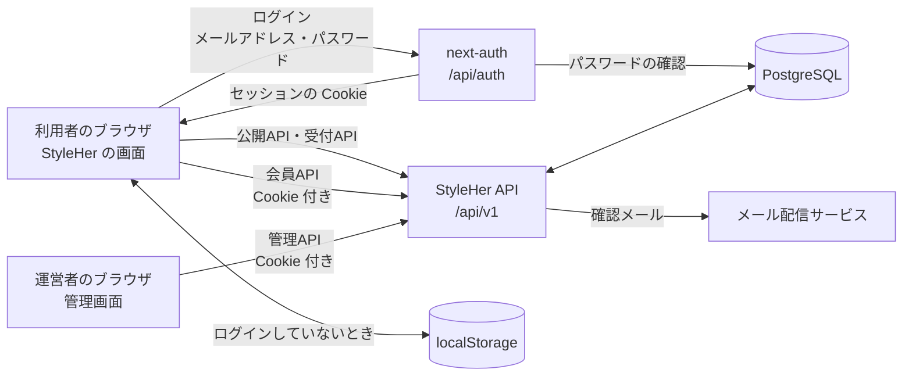
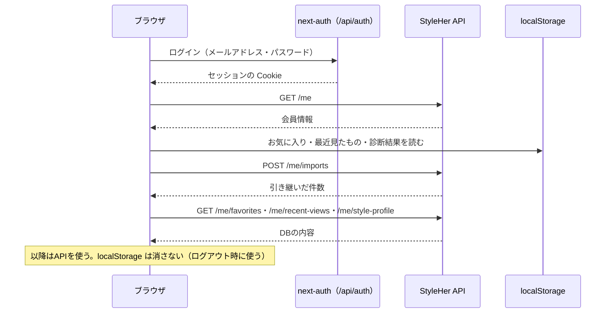

# API設計書

**プロジェクト名（仮）：** ファッショントレンド・コーディネート支援Webアプリ「StyleHer（スタイルハー）」
**作成日：** 2026年9月29日
**版数：** v0.5（next-auth によるログインと、APIの認可を追加）
**関連文書：** [プロジェクト仕様書・要件定義 v0.2](../プロジェクト仕様書_要件定義.md) / [設計書](../設計書.md) / [DB設計書 v0.2](db.md) / [ER図](er.md)

---

## 1. 本書の目的と範囲

MVPの StyleHer は **サーバーとAPIを持たない**。画面は `data.js`（Next.js 版は `lib/data.ts`）のデータを直接読み、お気に入りなどはブラウザ（localStorage）に保存している。

本書は、[DB設計書](db.md) のデータベースに画面からアクセスするための **Web API** を定める。APIが必要になるのは次の場面である。

| 場面 | 対応する機能 | 使うAPI |
|---|---|---|
| トレンド・コーデ・アイテムなどをDBから読んで表示する | F-01〜F-12, F-17, F-18 | 公開API（4.1） |
| 診断のおすすめを出す | F-16 | 公開API（4.1） |
| メールマガジンの登録、お問い合わせを受け付ける | F-20、お問い合わせ | 受付API（4.2） |
| お気に入り・最近見たもの・診断結果を複数の端末で同期する | F-21（F-13, F-16, F-19） | 会員API（4.3） |
| 運営者がブラウザからコンテンツを登録・編集する | F-15, F-22 | 管理API（4.4） |

- 画面の機能（F-01〜F-20）の動きは変えない。「今日の注目トレンド」の決め方、テイスト名などの表示用の文章は、今までどおり画面で持つ。
- ログインしていない人のお気に入り・最近見たもの・診断結果は、今までどおりブラウザに保存する。会員APIを使うのはログインした人だけ。

---

## 2. 前提と全体構成

### 2.1 前提

| 項目 | 内容 |
|---|---|
| 形式 | REST（リソースをURLで表し、HTTPメソッドで操作する）。データはJSON |
| 実装 | Next.js の Route Handlers（`app/api/v1/.../route.ts`）で作ることを想定する。今の Next.js 版は静的サイトとして書き出している（`next.config.ts` の `output: "export"`）ため、APIを動かすにはこの設定を外し、サーバーで動く環境（Vercel など）に置く必要がある（10章） |
| データベース | PostgreSQL（[DB設計書](db.md)） |
| 認証 | next-auth（Auth.js）で、メールアドレスとパスワードでログインする。ログインの状態は、next-auth が発行するセッションの Cookie（署名・暗号化した JWT）で持つ（3.4） |

### 2.2 全体構成図



---

## 3. 共通仕様

### 3.1 URL

```
https://{ドメイン}/api/v1/{リソース}
```

- 先頭に **バージョン**（`v1`）を付ける（バージョンの決め方は 3.10）。
- 本書では、以降 `/api/v1` を省略して書く（例：`GET /trends`）。

**パスの規則**

| 規則 | 良い例 | 悪い例 |
|---|---|---|
| リソースは **名詞の複数形**、英小文字・ハイフン区切り | `/hero-slides`、`/recent-views` | `/heroSlide`、`/recent_view` |
| **動詞を入れない**。操作は HTTP メソッドで表す | `PATCH /newsletter-subscriptions/{subscriptionId}` | `POST /newsletter-subscriptions/confirm` |
| 1件は `コレクション/{ID}`。下の階層もコレクション（複数形）にする | `/me/favorites/products/{productId}` | `/me/favorites/product/{id}` |
| 階層は **3段まで**（`/me` と `/admin` を含めない数え方で2段まで） | `/admin/contact-inquiries/{inquiryId}` | `/admin/products/{id}/links/{shopId}/clicks` |
| ただの属性（公開・非公開など）を下の階層に切り出さない。属性は `PATCH` で変える | `PATCH /admin/products/{productId}` | `PATCH /admin/products/{productId}/publication` |
| パスのパラメーター名は `{リソースの単数形}Id` | `{trendId}`、`{inquiryId}` | `{id}`、`{trend_id}` |
| 検索や推薦のように1つのリソースに収まらない結果も、**結果を名詞で表す** | `/search-results`、`/recommendations` | `/search`、`/recommend` |

`/me` は「ログインしている本人」を表す特別なリソースで、`/users/{userId}` の代わりに使う（他人のIDを指定させないため）。

### 3.2 データの形式

| 項目 | ルール | 例 |
|---|---|---|
| 文字コード | UTF-8 | |
| リクエスト・レスポンス | JSON（`Content-Type: application/json`） | |
| 項目名 | キャメルケース。DBの列名（スネークケース）をキャメルケースにしたもの | `hot_score` → `hotScore` |
| クエリパラメーター名 | 項目名と同じキャメルケース | `minPrice`、`isPublished` |
| 決まった値（列挙値） | 英小文字・スネークケース | `"price_asc"`、`"in_progress"` |
| 真偽値 | `is` ＋ 状態。`true` / `false` | `isPublished` |
| 複数の値（クエリ） | カンマ区切り | `ids=p01,p07` |
| ID | 文字列（DBの `code_id`）。メインビジュアル・コミュニティ画像・お問い合わせなど自動採番のものは数値 | `"p07"`、`3` |
| 日時 | ISO 8601、UTC | `"2026-09-29T03:15:00Z"` |
| 日付 | `YYYY-MM-DD` | `"2026-09-18"` |
| 金額 | 円の整数（税込） | `12900` |
| 画像 | DBの値をそのまま返す（Unsplash の画像ID、または画像のパス）。表示サイズに合わせたURLは画面で作る（[設計書](../設計書.md) 6.3） | `"1722859031306-4c81e8d83957"` |
| 値がないとき | 項目を省かず `null` を返す | `"mainProductId": null` |
| 並び順 | 一覧は特に書かない限り、DBの `sort_order` 順 | |
| 知らない項目 | 画面は、レスポンスに知らない項目があっても無視する（項目の追加でこわれないように。3.10）。APIは、リクエストに知らない項目があれば無視する | |

**返さない値**

| 返さないもの | 理由 |
|---|---|
| 内部の計算値（診断の点数など） | 画面の表示に使わず、計算方法を変えたときに画面が影響を受けるため |
| 本人が取得できないリソースの連番ID（お問い合わせ・メールマガジン登録の `id`） | 件数が推測できるため。管理APIでは返す |
| 公開APIでの、アイテムの検索キーワード・購入リンクの `customUrl`・`sortOrder`・`isPublished`・`createdAt`・`updatedAt` | 画面の表示に使わない内部の値。管理APIでは返す |
| パスワード・トークン・他人の個人情報 | 本DBには持たない、または本人以外には見せない |

画像（`image`）はDBの値（Unsplash の画像ID、または画像のパス）をそのまま返す。秘密の値ではなく、画面が表示サイズに合わせたURLを作るのに必要なため（[設計書](../設計書.md) 6.3）。

### 3.3 一覧の返し方

一覧は、配列を `items` に入れて返す。

```json
{
  "items": []
}
```

件数が多くなるもの（アイテム一覧、コラム一覧、管理APIの一覧、変更履歴）は、**ページ分け** する。すべて同じパラメーター・同じ形で返す。

| パラメーター | 説明 | 範囲 | 初期値 |
|---|---|---|---|
| `limit` | 1回に返す件数 | 1〜50（管理APIは1〜100） | APIごとに決める（アイテム一覧は10、管理APIは50） |
| `offset` | 先頭から何件飛ばすか | 0以上 | `0` |

- 範囲外の値は丸めずに `400 VALIDATION_ERROR` にする。
- `total`（条件に合う全件数）を返す。画面の「もっと見る（残り○件）」は `total - (offset + items の件数)` で求める。
- 並び順は必ず一意に決める（同じ値のときはIDの順にする）。ページをまたいで同じ行が2回出たり、抜けたりしないようにするため。

```json
{
  "items": [],
  "total": 25,
  "limit": 10,
  "offset": 0
}
```

トレンド・コーデ・ショップなど件数が少ないもの（数十件まで）は、ページ分けせずに全件を返す。件数が増えたら、同じ `limit` / `offset` を追加する（初期値を「全件」にすれば、今までの使い方は壊れない）。

変更履歴（`audit_logs`）は増え続けるため、件数が多くなって `offset` が遅くなったら、最後に受け取った `id` より前を取る方式（`beforeId`）を追加する。

### 3.4 認証

| 種類 | 付けるもの | 対象 |
|---|---|---|
| なし | — | 公開API・受付API |
| 会員 | ログインのセッションの Cookie（next-auth） | 会員API（`/me/...`） |
| 管理者 | 同上。さらにDBの `users.role` が `admin` であること | 管理API（`/admin/...`） |

- ログインは next-auth（Auth.js）で、メールアドレスとパスワードで行う（`/login`、`POST /api/auth/callback/credentials`）。パスワードは bcrypt のハッシュにして `users.password_hash` に保存する。
- セッションは、next-auth が署名・暗号化した JWT を Cookie（`authjs.session-token`、HttpOnly・SameSite=Lax）に入れて持つ。APIは、Cookie の署名・有効期限を確認し、中のユーザーIDで `users` を探す。
- ログインの試行は、同じIPから10分に10回まで。登録がない・パスワードが違うときは、どちらも同じエラーにする（メールアドレスの登録の有無が分からないように）。
- 管理者かどうかは、トークンの中身ではなく **DBの `users.role` で毎回確認する**（権限を外したらすぐに使えなくするため）。
- `401` のときは `WWW-Authenticate: Bearer` ヘッダーを付ける。
- 受付API（`POST /contact-inquiries`）は、ログインしていれば本人の記録に使い、していなくても受け付ける。Cookie が無効・期限切れのときは、未ログインとして扱う。

### 3.5 ステータスコード

| コード | 意味 | 使う場面 |
|---|---|---|
| 200 OK | 成功（本文あり） | 取得・更新 |
| 201 Created | 登録した。`Location` ヘッダーに登録したリソースのURLを入れる（本人が取得できないリソースは入れない） | お問い合わせ・管理APIの登録 |
| 202 Accepted | 受け付けた（あとで処理する） | メールマガジン登録（確認メールを送る） |
| 204 No Content | 成功（本文なし） | お気に入りの追加・削除、履歴の記録・削除、退会 |
| 304 Not Modified | 前回から変わっていない | 公開APIの `If-None-Match` が一致した（3.7） |
| 400 Bad Request | 入力がまちがっている | 入力チェックのエラー、JSONとして読めない |
| 401 Unauthorized | ログインしていない、トークンが無効 | 会員API・管理API |
| 403 Forbidden | 権限がない | 管理者でない人が管理APIを使った |
| 404 Not Found | 見つからない | 存在しない、または非公開のIDを指定した |
| 405 Method Not Allowed | そのパスでは使えないメソッド | 公開APIに `DELETE` を送った など。`Allow` ヘッダーで使えるメソッドを知らせる |
| 409 Conflict | 今の状態と合わない | IDがすでにある、使われているアイテムを非公開にしようとした |
| 412 Precondition Failed | 読み込んだあとに、ほかの人が更新した | 管理APIの更新で `If-Match` が一致しない（3.9） |
| 413 Content Too Large | 本文が大きすぎる | 本文が 100KB を超えた |
| 415 Unsupported Media Type | JSON ではない | `Content-Type` が `application/json` でない |
| 428 Precondition Required | 必要なヘッダーがない | 管理APIの更新に `If-Match` がない（3.9） |
| 429 Too Many Requests | 回数が多すぎる | 回数の制限（3.8）を超えた |
| 500 Internal Server Error | サーバーのエラー | 予期しないエラー |
| 503 Service Unavailable | 一時的に使えない | メンテナンス中、DBにつながらない。`Retry-After` を付ける |

成功のときの使い分け：本文を返すときは `200`（登録は `201`）、返す内容がないとき（お気に入りの追加・削除、履歴の記録・削除、退会）は `204`。処理を受け付けただけで、結果があとで決まるとき（確認メールを送るメールマガジン登録）は `202`。

### 3.6 エラーの返し方

エラーのときは、**すべてのAPIで** 次の形で返す（`Content-Type: application/json`）。

```json
{
  "error": {
    "code": "VALIDATION_ERROR",
    "message": "入力内容を確認してください。",
    "requestId": "req_01J9ZK3M5X8Q2T7V4N6B1C0D9E",
    "details": [
      { "field": "email", "message": "メールアドレスの形式が正しくありません。" },
      { "field": "message", "message": "お問い合わせ内容を10文字以上で入力してください。" }
    ]
  }
}
```

| 項目 | 必ずある | 説明 |
|---|---|---|
| `code` | ○ | エラーの種類（下の表）。画面はこの値で処理を分ける（`message` の文章で分けない） |
| `message` | ○ | そのまま画面に出せる日本語 |
| `requestId` | ○ | リクエストごとの番号。問い合わせを受けたとき、サーバーのログを探すのに使う（3.11） |
| `details` | — | 入力チェックのエラー（`VALIDATION_ERROR`）のときだけ。どの項目がまちがっているか。`field` はリクエストの項目名（入れ子は `links[0].shopId` の形） |
| `meta` | — | エラーの種類ごとの追加の情報（例：`PRODUCT_IN_USE` の使っているコーデのID） |

| `code` | ステータス | 意味 |
|---|---|---|
| `BAD_REQUEST` | 400 | JSONとして読めない など、入力チェックより前のエラー |
| `VALIDATION_ERROR` | 400 | 入力チェックのエラー。`details` にどの項目がまちがっているかを入れる |
| `UNAUTHENTICATED` | 401 | ログインしていない、トークンが無効・期限切れ |
| `FORBIDDEN` | 403 | 権限がない |
| `NOT_FOUND` | 404 | 見つからない |
| `METHOD_NOT_ALLOWED` | 405 | そのパスでは使えないメソッド |
| `ID_ALREADY_EXISTS` | 409 | 同じIDがすでにある（管理APIの登録） |
| `PRODUCT_IN_USE` | 409 | 公開中のコーデ・トレンドで使っているアイテムを非公開にしようとした（`meta` に使っているID） |
| `PRECONDITION_FAILED` | 412 | 読み込んだあとに、ほかの人が更新した（3.9） |
| `PAYLOAD_TOO_LARGE` | 413 | 本文が大きすぎる |
| `UNSUPPORTED_MEDIA_TYPE` | 415 | JSON ではない |
| `PRECONDITION_REQUIRED` | 428 | `If-Match` がない（3.9） |
| `INVALID_TOKEN` | 400 | メールマガジンの確認・配信停止のリンクが無効・期限切れ |
| `TOO_MANY_REQUESTS` | 429 | 回数の制限を超えた |
| `INTERNAL_ERROR` | 500 | サーバーのエラー。詳しい内容（SQL、スタックトレースなど）は返さず、`requestId` と一緒にサーバーのログにだけ残す |
| `SERVICE_UNAVAILABLE` | 503 | メンテナンス中など |

`code` の値は、一度決めたら変えない・意味を変えない（画面が処理を分けているため）。新しい値を足すのはよい。

### 3.7 キャッシュ

| API | `Cache-Control` | 理由 |
|---|---|---|
| 公開API（`GET`）：ブラウザ向け | `Cache-Control: public, max-age=60` | 内容は1日に数回しか変わらない。1分間はブラウザが保存した結果を使う |
| 公開API（`GET`）：CDN向け | `CDN-Cache-Control: public, max-age=300, stale-while-revalidate=86400` | CDNに置いて速く返す。古い結果を出しながら裏で取り直すのは CDN だけにする |
| 会員API・管理API・受付API | `no-store` | 個人のデータ・変更の結果を保存させない |

- **ブラウザには `stale-while-revalidate` を付けない。** 付けると、ブラウザが前日の古い結果をそのまま使うことがあり、アイテム一覧の「もっと見る」で古いページと新しいページがつながって、抜けや重複が起きる（画面からの利用時に確認した）。
- 公開APIは `ETag` を返し、`If-None-Match` が一致したら `304 Not Modified` を返す。
- 管理APIで更新したら、CDNのキャッシュを消して（再検証して）、すぐに反映させる。

### 3.8 回数の制限

いたずらや大量の送信を防ぐため、決められた時間内に呼べる回数を制限する。超えたら `429` と `Retry-After`（何秒後にやり直せるか）を返す。制限のあるAPIは、毎回 `RateLimit-Limit`（上限）・`RateLimit-Remaining`（残り）・`RateLimit-Reset`（リセットまでの秒数）を返す。

| API | 上限 | 数える単位 |
|---|---|---|
| `POST /contact-inquiries` | 10分に5回 | IPアドレス |
| `POST /newsletter-subscriptions` | 10分に5回 | IPアドレス |
| 会員API | 1分に60回 | ユーザー |
| 公開API | 1分に300回 | IPアドレス |

### 3.9 同時に編集したときの扱い（管理API）

2人の運営者が同じトレンドを同時に編集して、あとから保存した人が先の人の変更を知らずに消してしまうことを防ぐ。

- 管理APIの1件の取得（D-02）は、`ETag` ヘッダーを返す（`updated_at` から作る）。
- 更新（`PUT`・`PATCH`）のときは、受け取った値を `If-Match` ヘッダーに入れて送る。
- 今の値と違っていたら、保存せずに `412 PRECONDITION_FAILED` を返す。画面は「ほかの人が更新しました。読み込み直してください。」と表示する。
- `If-Match` がないときは `428 PRECONDITION_REQUIRED` を返す（付け忘れで上書きしないため）。

### 3.10 バージョンの決め方

| 変更 | 例 | バージョン |
|---|---|---|
| 今の使い方を壊さない変更 | 項目・APIの追加、任意のパラメーターの追加、列挙値の追加、エラーの `code` の追加 | `v1` のまま |
| 今の使い方を壊す変更 | 項目の削除・名前の変更・型の変更・意味の変更、必須パラメーターの追加、URLの変更 | `v2` を作る |

- URLには大きな番号（`v1`、`v2`）だけを入れる。細かい変更は改訂履歴に書く。
- `v2` を出したら、`v1` は **6か月以上** 残す。その間、`v1` のレスポンスに `Deprecation: true` と `Sunset`（終了日時）ヘッダーを付けて知らせる。
- 画面と API を同じ場所から同時に公開するので、ふだんは `v1` のまま追加していく。古い画面を開いたままの人のために、壊す変更は避ける。

### 3.11 リクエストIDとログ

- APIは、リクエストごとに番号（`requestId`）を作り、レスポンスの `X-Request-Id` ヘッダーとエラーの `requestId` に入れる。リクエストに `X-Request-Id` が付いていればそれを使う。
- サーバーのログには、日時・`requestId`・メソッド・パス・ステータス・処理時間・ユーザーID（ログイン中のみ）を残す。メールアドレス・お問い合わせ内容・トークン・パスワードは残さない。

### 3.12 その他の共通ルール

| 項目 | ルール |
|---|---|
| 本文の大きさ | 100KB まで（超えたら `413`） |
| 圧縮 | `Accept-Encoding` に合わせて gzip / br で返す |
| 二重送信の防止 | `POST /contact-inquiries` は `Idempotency-Key` ヘッダー（画面が作るランダムな文字列）を受け付ける。同じキーで24時間以内に再送されたら、保存せずに前回と同じ結果を返す（通信が切れて送り直したときに、同じお問い合わせが2件にならないように） |
| 稼働確認 | `GET /api/health`（バージョンなし・認証なし）。監視サービスが定期的に呼ぶ（4.5） |

---

## 4. API一覧

### 4.1 公開API（認証なし）

公開中（`is_published = true`）のデータだけを返す。非公開のIDを指定したときは、存在しないときと同じく `404` を返す。

| ID | メソッド | パス | 概要 | 対応機能 |
|---|---|---|---|---|
| A-01 | GET | `/masters` | マスタ（シーン・年代・テイスト・カテゴリー・カラー・コラムのタグ・お問い合わせの種類）をまとめて取得 | 共通 |
| A-02 | GET | `/trends` | トレンド一覧 | F-01, F-02, F-04 |
| A-03 | GET | `/trends/{trendId}` | トレンド詳細 | F-03 |
| A-04 | GET | `/outfits` | コーデ一覧（シーン・年代・テイストで絞り込み） | F-05, F-06 |
| A-05 | GET | `/outfits/{outfitId}` | コーデ詳細 | F-07 |
| A-06 | GET | `/products` | アイテム一覧（絞り込み・並び替え・ページ分け） | F-08 |
| A-07 | GET | `/products/{productId}` | アイテム詳細（ショップ比較・着回し提案） | F-09, F-10, F-11 |
| A-08 | GET | `/shops` | ショップ一覧 | F-17 |
| A-09 | GET | `/posts` | コラム一覧 | F-01, F-18 |
| A-10 | GET | `/posts/{postId}` | コラム記事 | F-18 |
| A-11 | GET | `/hero-slides` | メインビジュアルのスライド | F-01 |
| A-12 | GET | `/community-images` | コミュニティ告知の画像 | F-23（告知） |
| A-13 | GET | `/recommendations` | 診断の答えから、おすすめのトレンド・コーデを取得 | F-16 |
| A-14 | GET | `/search-results` | キーワード検索（5.14） | F-12 |

### 4.2 受付API（認証なし）

| ID | メソッド | パス | 概要 | 対応機能 |
|---|---|---|---|---|
| B-01 | POST | `/newsletter-subscriptions` | メールマガジンに登録する（確認メールを送る） | F-20 |
| B-02 | PATCH | `/newsletter-subscriptions/{subscriptionId}` | メールのリンクから、登録の確定・配信の停止をする（状態を変える） | F-20 |
| B-03 | POST | `/contact-inquiries` | お問い合わせを送る | お問い合わせ |

### 4.3 会員API（ログインが必要）

`/me` は「ログインしている本人」を表す。ほかの人のデータは、URLを変えても読み書きできない。

**メソッドの使い分け**

| 操作 | メソッド | 理由 |
|---|---|---|
| お気に入りの追加 | `PUT`（URLで対象を決める） | 何度送っても結果が同じ（べき等）。ハートボタンを連打しても二重にならない |
| 見たものの記録 | `POST`（新しい閲覧の記録） | 送るたびに「最後に見た日時」が変わるため、べき等ではない |
| 診断結果の保存 | `PUT`（まるごと置き換え） | 1人1件で、毎回すべての答えを送るため |
| 引き継ぎ | `POST`（引き継ぎの処理を1回行う） | 送った内容をDBに足す処理で、まるごと置き換えではないため |

| ID | メソッド | パス | 概要 | 対応機能 |
|---|---|---|---|---|
| C-01 | GET | `/me` | 自分の会員情報 | F-21 |
| C-02 | DELETE | `/me` | 退会する | F-21 |
| C-03 | GET | `/me/favorites` | お気に入り一覧 | F-13 |
| C-04 | PUT | `/me/favorites/{collection}/{itemId}` | お気に入りに追加する | F-13 |
| C-05 | DELETE | `/me/favorites/{collection}/{itemId}` | お気に入りから外す | F-13 |
| C-06 | GET | `/me/recent-views` | 最近見たもの | F-19 |
| C-07 | POST | `/me/recent-views` | 見たものを記録する | F-19 |
| C-08 | DELETE | `/me/recent-views` | 履歴を消す | F-19 |
| C-09 | GET | `/me/style-profile` | 診断結果を取得 | F-16 |
| C-10 | PUT | `/me/style-profile` | 診断結果を保存する | F-16 |
| C-11 | DELETE | `/me/style-profile` | 診断結果を消す（もう一度診断する） | F-16 |
| C-12 | POST | `/me/imports` | ブラウザに保存していた内容を引き継ぐ | F-21 |

### 4.4 管理API（管理者のみ）

| ID | メソッド | パス | 概要 | 対応機能 |
|---|---|---|---|---|
| D-01 | GET | `/admin/{resource}` | 一覧（非公開のものも含む） | F-22 |
| D-02 | GET | `/admin/{resource}/{id}` | 1件の取得（編集画面用） | F-22 |
| D-03 | POST | `/admin/{resource}` | 登録 | F-15, F-22 |
| D-04 | PUT | `/admin/{resource}/{id}` | 更新（すべての項目を送り、子テーブルの内容もまとめて置き換える） | F-15, F-22 |
| D-05 | PATCH | `/admin/{resource}/{id}` | 一部の項目だけを変える（公開・非公開の切り替え、並び順） | F-15, F-22 |
| D-06 | GET | `/admin/contact-inquiries` | お問い合わせ一覧 | お問い合わせ |
| D-07 | GET | `/admin/contact-inquiries/{inquiryId}` | お問い合わせの内容 | お問い合わせ |
| D-08 | PATCH | `/admin/contact-inquiries/{inquiryId}` | 対応状況を変える | お問い合わせ |
| D-09 | GET | `/admin/newsletter-subscriptions` | メールマガジン登録者の一覧 | F-20 |
| D-10 | GET | `/admin/audit-logs` | 変更履歴 | F-22 |

パスの `{id}` は、各リソースのIDを表す（例：`/admin/products/{productId}`、`/admin/hero-slides/{heroSlideId}`）。本書では、まとめて書くために `{resource}` と `{id}` を使っている。

**`{resource}` に入るもの**

| `{resource}` | テーブル | IDの種類 |
|---|---|---|
| `trends` | `trends` と子テーブル・中間テーブル | 文字列（登録時に指定） |
| `outfits` | `outfits` と子テーブル・中間テーブル | 文字列（登録時に指定） |
| `products` | `products`、`product_links` | 文字列（登録時に指定） |
| `posts` | `posts`、`post_paragraphs` | 文字列（登録時に指定） |
| `shops` | `shops` | 文字列（登録時に指定） |
| `hero-slides` | `hero_slides` | 数値（自動採番） |
| `community-images` | `community_images` | 数値（自動採番） |
| `scenes` / `ages` / `tastes` / `categories` / `colors` / `post-tags` / `inquiry-types` | 各マスタ | 文字列（登録時に指定） |

**削除のAPIは作らない。** DB設計書の方針どおり、マスタ・コンテンツは削除せず非公開にする（D-05）。`DELETE` を送ったときは `405 METHOD_NOT_ALLOWED` を返す。

`PUT` と `PATCH` の使い分け：編集画面で保存するときは、すべての項目を送る `PUT`（送らなかった項目は消える）。一覧画面で公開・非公開や並び順だけを変えるときは、変える項目だけを送る `PATCH`（送らなかった項目はそのまま）。

### 4.5 運用API

| ID | メソッド | パス | 概要 |
|---|---|---|---|
| Z-01 | GET | `/api/health` | 稼働確認。DBにつながれば `200` と `{ "status": "ok" }`、つながらなければ `503`。バージョンを付けず、認証もしない。中身（DBの種類・バージョンなど）は返さない |

---

## 5. 公開APIの詳細

### 5.0 よく使うデータの形

複数のAPIで同じ形を使う。

**トレンドの概要（TrendSummary）**：カード・一覧用

| 項目 | 型 | 説明 | DB |
|---|---|---|---|
| `id` | string | トレンドID | `trends.id` |
| `name` | string | トレンド名 | `trends.name` |
| `subtitle` | string | サブタイトル | `trends.subtitle` |
| `image` | string | メイン画像 | `trends.image` |
| `hotScore` | number | 注目度（0〜100） | `trends.hot_score` |
| `season` | string | 旬の時期 | `trends.season` |
| `postCount` | number | コーデ件数（表示用） | `trends.post_count` |
| `ageIds` | string[] | 対象の年代ID | `trend_ages` |
| `tasteIds` | string[] | テイストID | `trend_tastes` |

**コーデの概要（OutfitSummary）**：カード・一覧用

| 項目 | 型 | 説明 | DB |
|---|---|---|---|
| `id` | string | コーデID | `outfits.id` |
| `sceneId` | string | シーンID | `outfits.scene_id` |
| `title` | string | タイトル | `outfits.title` |
| `image` | string | コーデ画像 | `outfits.image` |
| `ageIds` | string[] | 対象の年代ID | `outfit_ages` |
| `tasteIds` | string[] | テイストID | `outfit_tastes` |
| `mainProductId` | string \| null | 写真の主役アイテムのID（サムネイルには出さない） | `outfit_products`（`role = 'main'`） |
| `items` | object[] | サムネイルに出すアイテム（`id`、`name`、`image`、`price`）。表示順 | `outfit_products`（`role = 'item'`）、`products` |
| `totalPrice` | number | アイテム合計金額（主役アイテムを含む） | 計算（[DB設計書](db.md) 7.2） |

**アイテムの概要（ProductSummary）**：カード・一覧用

| 項目 | 型 | 説明 | DB |
|---|---|---|---|
| `id` | string | アイテムID | `products.id` |
| `name` | string | アイテム名 | `products.name` |
| `categoryId` | string | カテゴリーID | `products.category_id` |
| `colorId` | string | カラーID | `products.color_id` |
| `price` | number | 参考価格（円・税込） | `products.price` |
| `image` | string | 画像 | `products.image` |
| `recommendedShopId` | string | おすすめのショップのID | `products.recommended_shop_id` |
| `purchaseUrl` | string | 「購入する」ボタンのリンク（おすすめのショップの購入リンク） | 計算（[DB設計書](db.md) 7.3） |
| `wearCount` | number | 着回し数（そのアイテムを使った公開中のコーデの件数） | 計算（[DB設計書](db.md) 7.2） |

カテゴリー名・カラー名・シーン名などは返さない。画面は A-01 で取得したマスタからIDで名前を引く。

---

### 5.1 A-01 マスタの取得

```
GET /masters
```

画面の選択肢・表示名に使うマスタを、まとめて1回で返す。公開中のものだけを `sort_order` 順に返す。

**レスポンス（200）**（各マスタの一部を省略）

```json
{
  "scenes": [
    { "id": "tsukin", "name": "通勤", "icon": "briefcase" },
    { "id": "kyujitsu", "name": "休日", "icon": "bag" }
  ],
  "ages": [
    { "id": "20s", "name": "20代" },
    { "id": "30s", "name": "30代" },
    { "id": "40s", "name": "40代" }
  ],
  "tastes": [
    { "id": "kireime", "name": "きれいめ" },
    { "id": "casual", "name": "カジュアル" }
  ],
  "categories": [
    { "id": "tops", "name": "トップス" },
    { "id": "outer", "name": "アウター" }
  ],
  "colors": [
    { "id": "white", "name": "白" },
    { "id": "gray", "name": "グレー" }
  ],
  "postTags": [
    { "id": "trend", "name": "トレンド" }
  ],
  "inquiryTypes": [
    { "id": "content", "name": "掲載内容について" }
  ]
}
```

- 画面の「すべて」の選択肢（`all`）は返さない。画面で先頭に足す。

使うテーブル：`scenes`、`ages`、`tastes`、`categories`、`colors`、`post_tags`、`inquiry_types`

### 5.2 A-02 トレンド一覧

```
GET /trends?age=30s
```

| パラメーター | 必須 | 説明 |
|---|---|---|
| `age` | — | 年代ID。指定すると、その年代が対象のトレンドだけを返す（F-02） |
| `ids` | — | トレンドIDをカンマ区切りで指定すると、そのトレンドだけを返す（最大50件）。ログインしていない人のお気に入り・最近見たものの表示に使う |

**レスポンス（200）**：`items` に TrendSummary の配列（一部省略）

```json
{
  "items": [
    {
      "id": "brown",
      "name": "秋のブラウンコーデ",
      "subtitle": "今季の主役カラー",
      "image": "1546859028-196808f21cd7",
      "hotScore": 93,
      "season": "2026秋冬",
      "postCount": 110,
      "ageIds": ["20s", "30s", "40s"],
      "tasteIds": ["kireime", "casual"]
    }
  ]
}
```

- **今日の注目トレンド（F-04）は画面で決める。** 閲覧者の日付で切り替えるため（[DB設計書](db.md) 7.1）。画面は、`age` を付けずに取得した一覧の並び順をもとに計算する。

使うテーブル：`trends`、`trend_ages`、`trend_tastes`

### 5.3 A-03 トレンド詳細

```
GET /trends/{trendId}
```

**レスポンス（200）**：TrendSummary の項目に、次を加えたもの

| 項目 | 型 | 説明 |
|---|---|---|
| `description` | string | 説明 |
| `images` | string[] | 追加画像（表示順） |
| `points` | string[] | ポイント（表示順） |
| `tips` | string[] | 着こなしと着回しのコツ（表示順） |
| `products` | ProductSummary[] | このトレンドのアイテム（表示順） |
| `relatedOutfits` | OutfitSummary[] | おすすめコーデ。このトレンドのテイストを1つでも含む公開中のコーデを、`sort_order` 順に最大3件（今の画面と同じ決め方） |

```json
{
  "id": "brown",
  "name": "秋のブラウンコーデ",
  "subtitle": "今季の主役カラー",
  "image": "1546859028-196808f21cd7",
  "hotScore": 93,
  "season": "2026秋冬",
  "postCount": 110,
  "ageIds": ["20s", "30s", "40s"],
  "tasteIds": ["kireime", "casual"],
  "description": "キャメル、モカ、チョコレート。深みのあるブラウンが今季の主役です。ベージュや白と合わせれば、やさしく大人っぽい秋の装いに。",
  "images": ["1544243747-b8ca15da2450", "1606534498512-1f073c93b9eb", "1617549765706-1c32193944ff"],
  "points": ["キャメルのロングコート", "テラコッタ・モカのニット", "ブラウンのローファーやブーツ"],
  "tips": [
    "ブラウン×白で明るく、ブラウン×黒で引き締め",
    "濃淡のブラウンを重ねるワントーンコーデが今年らしい",
    "黄み肌さんはキャメル、青み肌さんはグレージュ寄りが似合う"
  ],
  "products": [
    {
      "id": "p08",
      "name": "ロングチェスターコート",
      "categoryId": "outer",
      "colorId": "camel",
      "price": 15900,
      "image": "1635521248661-97f832387a70",
      "recommendedShopId": "amazon",
      "purchaseUrl": "https://www.amazon.co.jp/s?k=%E3%83%81%E3%82%A7%E3%82%B9%E3%82%BF%E3%83%BC%E3%82%B3%E3%83%BC%E3%83%88%20%E3%82%AD%E3%83%A3%E3%83%A1%E3%83%AB%20%E3%83%AC%E3%83%87%E3%82%A3%E3%83%BC%E3%82%B9",
      "wearCount": 1
    }
  ],
  "relatedOutfits": [
    {
      "id": "o01",
      "sceneId": "tsukin",
      "title": "白シャツで清潔感のある通勤コーデ",
      "image": "1758600587839-56ba05596c69",
      "ageIds": ["20s", "30s", "40s"],
      "tasteIds": ["kireime", "simple"],
      "mainProductId": null,
      "items": [
        { "id": "p01", "name": "レギュラーカラー白シャツ", "image": "1603252109303-2751441dd157", "price": 3990 },
        { "id": "p09", "name": "センタープレスワイドパンツ", "image": "1632282005753-29f80ed13c93", "price": 4990 },
        { "id": "p17", "name": "ポインテッドパンプス", "image": "1621996659490-3275b4d0d951", "price": 5990 }
      ],
      "totalPrice": 14970
    }
  ]
}
```

（`products` は4件中1件、`relatedOutfits` は3件中1件だけを載せている）

**エラー**：`404 NOT_FOUND`（存在しない、または非公開）

使うテーブル：`trends`、`trend_images`、`trend_points`、`trend_tips`、`trend_ages`、`trend_tastes`、`trend_products`、`products`、`product_links`、`shops`、`outfits`、`outfit_products`、`outfit_ages`、`outfit_tastes`

### 5.4 A-04 コーデ一覧

```
GET /outfits?scene=tsukin&age=30s&taste=kireime
```

| パラメーター | 必須 | 説明 |
|---|---|---|
| `scene` | — | シーンID。省略すると全シーン |
| `age` | — | 年代ID。その年代が対象のコーデだけ |
| `taste` | — | テイストID。そのテイストを含むコーデだけ |
| `ids` | — | コーデIDをカンマ区切り（最大50件）。お気に入り・最近見たものの表示用 |

- 条件はすべて満たすもの（AND）を返す（[設計書](../設計書.md) 4.3。SQLは [DB設計書](db.md) 7.4）。
- 存在しないシーン・年代・テイストのIDを指定したときは `400 VALIDATION_ERROR`。

**レスポンス（200）**：`items` に OutfitSummary の配列

上の例（通勤 × 30代 × きれいめ）では、`o01`（合計 ¥14,970）、`o02`（¥23,880）、`o03`（¥16,470）の3件を返す。0件のときは `"items": []` を返し、画面が「条件に合うコーデがありません。」と表示する。

使うテーブル：`outfits`、`outfit_ages`、`outfit_tastes`、`outfit_products`、`products`

### 5.5 A-05 コーデ詳細

```
GET /outfits/{outfitId}
```

**レスポンス（200）**：OutfitSummary の項目に、次を加えたもの

| 項目 | 型 | 説明 |
|---|---|---|
| `description` | string | 説明 |
| `tips` | string[] | 着こなしのコツ（表示順） |
| `products` | object[] | コーデのアイテム。ProductSummary に `role`（`main` または `item`）を加えたもの。主役アイテムを先頭、残りは表示順 |

```json
{
  "id": "o25",
  "sceneId": "kyujitsu",
  "title": "キャメルコートで秋の週末",
  "image": "1546859028-196808f21cd7",
  "ageIds": ["20s", "30s", "40s"],
  "tasteIds": ["kireime", "casual"],
  "mainProductId": "p08",
  "items": [
    { "id": "p03", "name": "リブタートルネックニット", "image": "1601379327928-bedfaf9da2d0", "price": 3490 },
    { "id": "p12", "name": "ストレートデニム", "image": "1602293589930-45aad59ba3ab", "price": 5990 },
    { "id": "p18", "name": "サイドジップショートブーツ", "image": "1605733160314-4fc7dac4bb16", "price": 8990 }
  ],
  "totalPrice": 34370,
  "description": "今季の主役カラー、キャメルのロングコート。デニムとブーツでカジュアルに着ても、きちんと見えます。",
  "tips": ["インナーはボルドーや白で季節感を", "コートの前は開けて縦のラインを強調"],
  "products": [
    {
      "role": "main",
      "id": "p08",
      "name": "ロングチェスターコート",
      "categoryId": "outer",
      "colorId": "camel",
      "price": 15900,
      "image": "1635521248661-97f832387a70",
      "recommendedShopId": "amazon",
      "purchaseUrl": "https://www.amazon.co.jp/s?k=%E3%83%81%E3%82%A7%E3%82%B9%E3%82%BF%E3%83%BC%E3%82%B3%E3%83%BC%E3%83%88%20%E3%82%AD%E3%83%A3%E3%83%A1%E3%83%AB%20%E3%83%AC%E3%83%87%E3%82%A3%E3%83%BC%E3%82%B9",
      "wearCount": 1
    }
  ]
}
```

（`products` は4件中1件だけを載せている。`totalPrice` は 15,900 + 3,490 + 5,990 + 8,990 = 34,370 円）

**エラー**：`404 NOT_FOUND`

使うテーブル：`outfits`、`outfit_products`、`outfit_tips`、`outfit_ages`、`outfit_tastes`、`products`、`product_links`、`shops`

### 5.6 A-06 アイテム一覧

```
GET /products?category=outer&minPrice=7000&sort=price_asc&limit=10&offset=0
```

| パラメーター | 必須 | 初期値 | 説明 |
|---|---|---|---|
| `category` | — | | カテゴリーID |
| `color` | — | | カラーID |
| `minPrice` | — | | この金額以上（円） |
| `maxPrice` | — | | この金額以下（円） |
| `sort` | — | `recommended` | `recommended`（おすすめ順）/ `price_asc`（価格が安い順）/ `price_desc`（価格が高い順）/ `wear_count_desc`（着回しできる順） |
| `limit` | — | `10` | 1〜50 |
| `offset` | — | `0` | 0以上 |
| `ids` | — | | アイテムIDをカンマ区切り（最大50件）。お気に入り・最近見たものの表示用 |

- 画面の価格帯の選択肢は、次のように変換して送る：〜¥2,999 → `maxPrice=2999`、¥3,000〜¥6,999 → `minPrice=3000&maxPrice=6999`、¥7,000〜 → `minPrice=7000`。
- 同じ価格・同じ着回し数のときは、おすすめ順（`sort_order`）で並べる。
- 「もっと見る」は `offset` を10ずつ増やして呼ぶ。条件を変えたら `offset=0` に戻す（[設計書](../設計書.md) 4.3）。

**レスポンス（200）**：`items` に ProductSummary の配列と、ページ分けの項目

```json
{
  "items": [
    {
      "id": "p07",
      "name": "トレンチコート",
      "categoryId": "outer",
      "colorId": "beige",
      "price": 12900,
      "image": "1722859031306-4c81e8d83957",
      "recommendedShopId": "rakuten",
      "purchaseUrl": "https://search.rakuten.co.jp/search/mall/%E3%83%88%E3%83%AC%E3%83%B3%E3%83%81%E3%82%B3%E3%83%BC%E3%83%88%20%E3%83%AC%E3%83%87%E3%82%A3%E3%83%BC%E3%82%B9%20%E3%83%99%E3%83%BC%E3%82%B8%E3%83%A5/",
      "wearCount": 2
    },
    {
      "id": "p08",
      "name": "ロングチェスターコート",
      "categoryId": "outer",
      "colorId": "camel",
      "price": 15900,
      "image": "1635521248661-97f832387a70",
      "recommendedShopId": "amazon",
      "purchaseUrl": "https://www.amazon.co.jp/s?k=%E3%83%81%E3%82%A7%E3%82%B9%E3%82%BF%E3%83%BC%E3%82%B3%E3%83%BC%E3%83%88%20%E3%82%AD%E3%83%A3%E3%83%A1%E3%83%AB%20%E3%83%AC%E3%83%87%E3%82%A3%E3%83%BC%E3%82%B9",
      "wearCount": 1
    }
  ],
  "total": 2,
  "limit": 10,
  "offset": 0
}
```

**エラー**：`400 VALIDATION_ERROR`（`sort` の値がちがう、`limit` が範囲外、`minPrice` が `maxPrice` より大きい など）

使うテーブル：`products`、`product_links`、`shops`、`outfit_products`、`outfits`

### 5.7 A-07 アイテム詳細

```
GET /products/{productId}
```

**レスポンス（200）**：ProductSummary の項目に、次を加えたもの

| 項目 | 型 | 説明 |
|---|---|---|
| `links` | object[] | 購入リンク（ショップ比較・F-10）。`shopId`、`shopName`、`url`。おすすめのショップが先頭、残りはショップの並び順 |
| `trends` | object[] | このアイテムが入っている公開中のトレンド（`id`、`name`、`image`） |
| `outfits` | OutfitSummary[] | このアイテムを使った公開中のコーデ（着回し提案・F-11）。件数は `wearCount` と同じ |

```json
{
  "id": "p07",
  "name": "トレンチコート",
  "categoryId": "outer",
  "colorId": "beige",
  "price": 12900,
  "image": "1722859031306-4c81e8d83957",
  "recommendedShopId": "rakuten",
  "purchaseUrl": "https://search.rakuten.co.jp/search/mall/%E3%83%88%E3%83%AC%E3%83%B3%E3%83%81%E3%82%B3%E3%83%BC%E3%83%88%20%E3%83%AC%E3%83%87%E3%82%A3%E3%83%BC%E3%82%B9%20%E3%83%99%E3%83%BC%E3%82%B8%E3%83%A5/",
  "wearCount": 2,
  "links": [
    {
      "shopId": "rakuten",
      "shopName": "楽天市場",
      "url": "https://search.rakuten.co.jp/search/mall/%E3%83%88%E3%83%AC%E3%83%B3%E3%83%81%E3%82%B3%E3%83%BC%E3%83%88%20%E3%83%AC%E3%83%87%E3%82%A3%E3%83%BC%E3%82%B9%20%E3%83%99%E3%83%BC%E3%82%B8%E3%83%A5/"
    },
    {
      "shopId": "amazon",
      "shopName": "Amazon",
      "url": "https://www.amazon.co.jp/s?k=%E3%83%88%E3%83%AC%E3%83%B3%E3%83%81%E3%82%B3%E3%83%BC%E3%83%88%20%E3%83%AC%E3%83%87%E3%82%A3%E3%83%BC%E3%82%B9%20%E3%83%99%E3%83%BC%E3%82%B8%E3%83%A5"
    }
  ],
  "trends": [
    { "id": "kireime", "name": "きれいめカジュアル", "image": "1514813836041-518668f092b1" }
  ],
  "outfits": [
    {
      "id": "o04",
      "sceneId": "tsukin",
      "title": "ベージュコートで大人の通勤",
      "image": "1641387103830-6ab162de6aad",
      "ageIds": ["40s"],
      "tasteIds": ["kireime"],
      "mainProductId": null,
      "items": [
        { "id": "p07", "name": "トレンチコート", "image": "1722859031306-4c81e8d83957", "price": 12900 },
        { "id": "p20", "name": "レザーハンドバッグ", "image": "1614179689702-355944cd0918", "price": 12900 },
        { "id": "p18", "name": "サイドジップショートブーツ", "image": "1605733160314-4fc7dac4bb16", "price": 8990 }
      ],
      "totalPrice": 34790
    }
  ]
}
```

（`outfits` は2件中1件だけを載せている）

- 購入リンクのURLは、APIが作って返す。`product_links.custom_url` があればそれを、なければショップの検索URLの型に検索キーワードを入れて作る（[DB設計書](db.md) 7.3）。**検索キーワード（`search_keyword`）そのものは公開APIでは返さない。**
- 画面は、リンクの下に「各ショップの検索結果ページが開きます。価格や在庫はショップでご確認ください。」と表示する（今までどおり）。

**エラー**：`404 NOT_FOUND`

使うテーブル：`products`、`product_links`、`shops`、`trend_products`、`trends`、`outfit_products`、`outfits`、`outfit_ages`、`outfit_tastes`

### 5.8 A-08 ショップ一覧

```
GET /shops
```

**レスポンス（200）**（一部省略）

```json
{
  "items": [
    { "id": "uniqlo", "name": "UNIQLO", "url": "https://www.uniqlo.com/jp/ja/", "shopType": "ベーシック" },
    { "id": "rakuten", "name": "楽天市場", "url": "https://www.rakuten.co.jp/", "shopType": "総合通販" }
  ]
}
```

使うテーブル：`shops`

### 5.9 A-09 コラム一覧

```
GET /posts?tag=trend&limit=4&offset=0
```

| パラメーター | 必須 | 初期値 | 説明 |
|---|---|---|---|
| `tag` | — | | タグID |
| `limit` | — | `20` | 1〜50。トップページの「新着コラム」は `limit=4` |
| `offset` | — | `0` | ページ分け（3.3） |

**レスポンス（200）**：公開日の新しい順（同じ日はIDの順）。本文（`paragraphs`）は含めない。ページ分けの項目（`total`・`limit`・`offset`）も返す

```json
{
  "items": [
    {
      "id": "a01",
      "title": "2026年秋冬トレンド6選｜今年はブラウンが主役",
      "tagId": "trend",
      "publishedOn": "2026-09-18",
      "image": "1724916351483-75e80b270517",
      "excerpt": "きれいめカジュアルから秋のブラウンまで。この秋冬に押さえておきたいトレンドをまとめました。"
    }
  ],
  "total": 4,
  "limit": 4,
  "offset": 0
}
```

使うテーブル：`posts`

### 5.10 A-10 コラム記事

```
GET /posts/{postId}
```

**レスポンス（200）**：一覧の項目に `paragraphs`（本文の段落の配列、順番どおり）を加えたもの。

**エラー**：`404 NOT_FOUND`

使うテーブル：`posts`、`post_paragraphs`

### 5.11 A-11 メインビジュアル

```
GET /hero-slides
```

```json
{
  "items": [
    {
      "id": 1,
      "image": "1527063652841-2920dd529e30",
      "imagePosition": "center 35%",
      "title": "おしゃれは、\nもっと簡単に。",
      "body": "今日のトレンド、シーン別コーデ、人気ショップまで。忙しい毎日でも、わたしらしい着こなしが見つかる場所。"
    }
  ]
}
```

- `title` の改行は `\n` で返す。画面は文字をエスケープしてから、改行を `<br>` に変えて表示する（HTMLは返さない）。

使うテーブル：`hero_slides`

### 5.12 A-12 コミュニティ告知の画像

```
GET /community-images
```

```json
{
  "items": [
    { "id": 1, "image": "1697731136759-c2963bf94075" }
  ]
}
```

使うテーブル：`community_images`

### 5.13 A-13 診断のおすすめ

```
GET /recommendations?age=30s&tastes=kireime,simple&scene=tsukin
```

かんたんスタイル診断（F-16）の3問の答えから、おすすめのトレンド（上位2件）とコーデ（上位4件）を返す。**ログインしていなくても使える**（結果は保存しない。保存は C-10）。

| パラメーター | 必須 | 説明 |
|---|---|---|
| `age` | ○ | Q1 の年代ID |
| `tastes` | ○ | Q2 のテイストID。カンマ区切りで1〜2個。**1つ目を重視する** |
| `scene` | ○ | Q3 のシーンID |

点数の付け方は [設計書](../設計書.md) 4.9 のとおり（SQLは [DB設計書](db.md) 7.6）。0点のものは返さず、同じ点数なら `sort_order` 順。

**レスポンス（200）**

```json
{
  "trends": [
    { "id": "kireime", "name": "きれいめカジュアル", "subtitle": "上品で、ちゃんと見える", "image": "1514813836041-518668f092b1", "hotScore": 95, "season": "2026秋冬", "postCount": 128, "ageIds": ["20s", "30s", "40s"], "tasteIds": ["kireime", "simple"] },
    { "id": "office", "name": "オフィスカジュアル", "subtitle": "通勤服は、きちんとラクに", "image": "1774205884993-86c63afbe871", "hotScore": 91, "season": "通年", "postCount": 142, "ageIds": ["20s", "30s", "40s"], "tasteIds": ["kireime", "simple"] }
  ],
  "outfits": [
    { "id": "o01", "sceneId": "tsukin", "title": "白シャツで清潔感のある通勤コーデ", "image": "1758600587839-56ba05596c69", "ageIds": ["20s", "30s", "40s"], "tasteIds": ["kireime", "simple"], "mainProductId": null, "items": [], "totalPrice": 14970 }
  ]
}
```

（`outfits` は `o01`、`o03`、`o02`、`o04` の4件中1件だけを載せ、`items` も省略している）

- 各要素は TrendSummary / OutfitSummary。点の高い順に並べて返す。**点数そのものは返さない**（画面の表示に使わない内部の値のため）。
- 「あなたは『きれいめ×シンプル』タイプ」のようなタイプ名と説明文は、今までどおり画面で作る。

**エラー**：`400 VALIDATION_ERROR`（未回答の質問がある、テイストが3つ以上、同じテイストを2回指定、存在しないID）。メッセージは「3つの質問すべてに答えてください」「テイストは2つまで選べます」（今の画面と同じ）。

使うテーブル：`trends`、`trend_ages`、`trend_tastes`、`outfits`、`outfit_ages`、`outfit_tastes`、`outfit_products`、`products`

### 5.14 A-14 キーワード検索

```
GET /search-results?q=ニット%20通勤
```

当初は第2段階（画面で検索）の予定だったが、コラムの本文まで検索するには全データを画面に読み込む必要があるため、**画面からこのAPIを使う** ことにした（v0.4）。結果は画面での検索と同じになることを確認している。

| パラメーター | 必須 | 説明 |
|---|---|---|
| `q` | ○ | キーワード（1〜100文字）。スペースで区切ると、すべての語を含むもの（AND）を探す |
| `limit` | — | 種類ごとの最大件数（初期値20、最大50） |

- 表記ゆれは今の画面と同じ手順（NFKC 正規化 → 英字を小文字に → カタカナをひらがなに）でそろえてから比べる。
- 検索する項目は [設計書](../設計書.md) 4.7 と同じ。

**レスポンス（200）**

```json
{
  "query": "ニット 通勤",
  "trends": { "items": [], "total": 0 },
  "outfits": { "items": [], "total": 1 },
  "products": { "items": [], "total": 0 },
  "posts": { "items": [], "total": 0 },
  "shops": { "items": [], "total": 0 }
}
```

（`items` の中身は省略。形はそれぞれ TrendSummary / OutfitSummary / ProductSummary / A-09 のコラム / A-08 のショップ）

---

## 6. 受付APIの詳細

### 6.1 B-01 メールマガジンに登録する

```
POST /newsletter-subscriptions
```

**リクエスト**

```json
{ "email": "hanako@example.com" }
```

| 項目 | 必須 | チェック |
|---|---|---|
| `email` | ○ | 前後の空白を除いて、`文字@文字.文字` の形（空白を含まない）。254文字以内 |

**レスポンス（202）**

```json
{ "message": "確認メールを送りました。メールのリンクを開くと登録が完了します。" }
```

- `status = 'pending'` で登録し、確認のリンクを書いたメールを送る（ダブルオプトイン）。
- **すでに登録されているアドレスでも、同じ202を返す**（アドレスが登録済みかどうかを、他人が調べられないようにするため）。配信中の人には何も送らず、確認待ち・配信停止中の人には確認メールを送り直す。
- MVP（F-20）では、このAPIは使わず、画面の入力チェックだけを行う（今までどおり）。実際に配信を始めるときに使う。

**エラー**：`400 VALIDATION_ERROR`（「メールアドレスの形式が正しくありません。」）、`429 TOO_MANY_REQUESTS`

レスポンスに登録の `id` は返さない（確認メールのリンクにだけ入れる）。

使うテーブル：`newsletter_subscriptions`

### 6.2 B-02 登録の確定・配信の停止

```
PATCH /newsletter-subscriptions/{subscriptionId}
```

確認メール・配信メールのリンクから、登録の状態を変える。「確定する」「停止する」という動詞をパスに入れず、**登録（リソース）の `status` を変える** 操作として表す。

**リクエスト**

```json
{ "status": "active", "token": "（メールのリンクに入っている文字列）" }
```

| 項目 | 必須 | 説明 |
|---|---|---|
| `status` | ○ | `active`（登録を確定する）または `unsubscribed`（配信を停止する） |
| `token` | ○ | メールのリンクに入っている、変更してよいことの証明 |

- この操作にはログインが要らない代わりに、`token` が必要。トークンは、登録ID・変えてよい状態（`active` か `unsubscribed`）・有効期限をサーバーの秘密の鍵で署名したもの。DBには保存しない。パスの `subscriptionId` とトークンの中の登録IDが一致しないとき、`status` がトークンで許された値でないときは `400 INVALID_TOKEN`。
- 確認のトークンの有効期限は **7日**。配信停止のトークン（毎回のメールの末尾に載せる）は期限なし。
- `active` にすると `confirmed_at` を、`unsubscribed` にすると `unsubscribed_at` を記録する。すでにその状態なら何もせず成功を返す（べき等）。
- メールのリンクは画面のページ（例：`/newsletter?subscription=…&token=…`）を開き、そのページがこのAPIを呼ぶ。リンクを開いただけ（メールソフトの自動確認など）で状態が変わらないよう、GET では変えない。
- トークンはURLのパスやクエリではなく本文で送る（サーバーやCDNのアクセスログに残さないため）。

**レスポンス（200）**

```json
{ "status": "active" }
```

**エラー**：`400 VALIDATION_ERROR`（`status` の値がちがう）、`400 INVALID_TOKEN`（「リンクの有効期限が切れています。もう一度登録してください。」）、`404 NOT_FOUND`（登録が見つからない）

使うテーブル：`newsletter_subscriptions`

### 6.3 B-03 お問い合わせを送る

```
POST /contact-inquiries
```

**リクエスト**

```json
{
  "name": "山田 花子",
  "email": "hanako@example.com",
  "inquiryTypeId": "content",
  "message": "トレンドの記事について質問があります。",
  "website": ""
}
```

| 項目 | 必須 | チェック（エラーメッセージは今のフォームと同じ） |
|---|---|---|
| `name` | ○ | 前後の空白を除いて1〜50文字 |
| `email` | ○ | `文字@文字.文字` の形。254文字以内 |
| `inquiryTypeId` | ○ | 公開中の `inquiry_types` のID |
| `message` | ○ | 前後の空白を除いて10〜1000文字 |
| `website` | — | **スパム対策の見えない入力欄**。人には見えないので、値が入っていたら機械の送信とみなす |

- `website` に値が入っていたときは、**保存せずに201を返す**（機械に見破られないようにするため）。
- ログイン中（`Authorization` あり）なら、`user_id` も記録する。
- `Idempotency-Key` ヘッダーがあれば、同じキーでの再送は保存せずに前回と同じ結果を返す（3.12）。
- 登録後、運営者に通知メールを送る。

**レスポンス（201）**

```json
{ "receivedAt": "2026-09-29T03:15:00Z" }
```

- 送った本人はお問い合わせを取得できないため、`Location` ヘッダーと連番の `id` は返さない（件数が推測できないように）。

**エラー**：`400 VALIDATION_ERROR`、`429 TOO_MANY_REQUESTS`

使うテーブル：`contact_inquiries`、`inquiry_types`

---

## 7. 会員APIの詳細

すべてログイン（セッションの Cookie）が必要。ないとき・無効なときは `401 UNAUTHENTICATED`（3.4）。

### 7.1 C-01 自分の会員情報 / C-02 退会する

```
GET /me
DELETE /me
```

**レスポンス（GET・200）**

```json
{
  "id": "9b1f6c2e-3a4d-4e5f-8a7b-1c2d3e4f5a6b",
  "email": "hanako@example.com",
  "role": "member",
  "createdAt": "2026-09-29T03:15:00Z"
}
```

- **GET はデータを変えない。** `last_login_at` は、ログインしたとき（next-auth の確認が通ったとき）に更新する。会員登録（`users` の行を作る）は今後の対応で、今は開発用の会員（初期データ）だけがいる。
- `users` に行がないとき（登録の処理が失敗したときなど）は `404 NOT_FOUND`。画面はログアウトして、もう一度ログインしてもらう。
- DELETE は、`users` の行（ログイン用のパスワードのハッシュを含む）を削除し、`204` を返す。お気に入り・最近見たもの・診断結果も一緒に消える（[DB設計書](db.md) 5章）。お問い合わせの記録は残る（本人とのつながりだけ外れる）。

使うテーブル：`users`

### 7.2 C-03 お気に入り一覧

```
GET /me/favorites
```

**レスポンス（200）**：種類ごとに、登録した順

```json
{
  "trends": [
    { "id": "brown", "name": "秋のブラウンコーデ", "subtitle": "今季の主役カラー", "image": "1546859028-196808f21cd7", "hotScore": 93, "season": "2026秋冬", "postCount": 110, "ageIds": ["20s", "30s", "40s"], "tasteIds": ["kireime", "casual"] }
  ],
  "outfits": [],
  "products": []
}
```

- 各要素は TrendSummary / OutfitSummary / ProductSummary。
- 非公開になったものは返さない（お気に入りの行は消さずに残す。公開に戻ったらまた出る）。ヘッダーの件数バッジは、この3つの配列の件数の合計。

使うテーブル：`favorites`、`trends`、`outfits`、`products` ほか各概要に必要なテーブル

### 7.3 C-04 お気に入りに追加する / C-05 お気に入りから外す

```
PUT /me/favorites/{collection}/{itemId}
DELETE /me/favorites/{collection}/{itemId}
```

| パスの値 | 説明 |
|---|---|
| `collection` | `trends` / `outfits` / `products`（公開APIのコレクション名と同じ複数形） |
| `itemId` | トレンド・コーデ・アイテムのID |

例：`PUT /me/favorites/products/p07`

本文は送らない（追加する対象はURLで決まる）。

- どちらも **何度呼んでも結果が同じ**（すでに追加済みのものを PUT しても、ないものを DELETE してもエラーにしない）。画面のハートボタンを連打しても安全にするため。
- 成功したら `204`（本文なし）。画面はトースト（「お気に入りに追加しました」など）を出す。

**エラー**：`404 NOT_FOUND`（`collection` がちがう、または PUT で存在しない・非公開のIDを指定した）

使うテーブル：`favorites`

### 7.4 C-06 最近見たもの / C-07 記録する / C-08 履歴を消す

```
GET /me/recent-views
POST /me/recent-views
DELETE /me/recent-views
```

**C-07 のリクエスト**：トレンド・コーデ・アイテムの詳細を開いたときに呼ぶ（コラムは記録しない）。`type` は列挙値なので単数形の `trend` / `outfit` / `product`（パスのコレクション名とは別）

```json
{ "type": "product", "id": "p07" }
```

- 同じものは1件だけ（見直したら日時を更新して先頭へ）。1人最大8件で、古いものから消える（SQLは [DB設計書](db.md) 7.5）。成功したら `204`。
- 画面の表示を待たせないよう、画面はこのAPIの結果を待たずに詳細を表示する。

**C-06 のレスポンス（200）**：新しい順、最大8件。`item` の形は `type` に合わせて TrendSummary / OutfitSummary / ProductSummary

```json
{
  "items": [
    {
      "type": "product",
      "viewedAt": "2026-09-29T03:20:00Z",
      "item": {
        "id": "p07",
        "name": "トレンチコート",
        "categoryId": "outer",
        "colorId": "beige",
        "price": 12900,
        "image": "1722859031306-4c81e8d83957",
        "recommendedShopId": "rakuten",
        "purchaseUrl": "https://search.rakuten.co.jp/search/mall/%E3%83%88%E3%83%AC%E3%83%B3%E3%83%81%E3%82%B3%E3%83%BC%E3%83%88%20%E3%83%AC%E3%83%87%E3%82%A3%E3%83%BC%E3%82%B9%20%E3%83%99%E3%83%BC%E3%82%B8%E3%83%A5/",
        "wearCount": 2
      }
    }
  ]
}
```

- C-08 はすべて消して `204` を返す（「履歴を消す」ボタン）。

**エラー**：`400 VALIDATION_ERROR`、`404 NOT_FOUND`（C-07 で存在しない・非公開のIDを指定した）

使うテーブル：`recent_views` ほか各概要に必要なテーブル

### 7.5 C-09 診断結果を取得 / C-10 保存する / C-11 消す

```
GET /me/style-profile
PUT /me/style-profile
DELETE /me/style-profile
```

**C-10 のリクエスト**（C-09 のレスポンスも同じ形に `updatedAt` を加えたもの）

```json
{ "ageId": "30s", "tasteIds": ["kireime", "simple"], "sceneId": "tsukin" }
```

| 項目 | 必須 | チェック |
|---|---|---|
| `ageId` | ○ | 公開中の年代ID |
| `tasteIds` | ○ | 公開中のテイストIDを1〜2個。同じものは不可。1つ目を重視する（`priority` 1・2 として保存） |
| `sceneId` | ○ | 公開中のシーンID |

- C-09：診断結果がないときは `404 NOT_FOUND`（画面は質問を表示する）。
- C-10：保存した内容を `200` で返す。おすすめの取得は A-13 を使う。
- C-11：「もう一度診断する」で呼ぶ。`204`。診断結果がなくても `204`（べき等）。

使うテーブル：`style_profiles`、`style_profile_tastes`

### 7.6 C-12 ブラウザに保存していた内容を引き継ぐ

```
POST /me/imports
```

ログインした直後に1回呼ぶ。localStorage の値を **そのままの形で** 送る（[DB設計書](db.md) 8.2）。

**リクエスト**

```json
{
  "favorites": { "trend": ["brown"], "outfit": ["o01"], "product": ["p07"] },
  "recent": ["product:p07", "trend:brown"],
  "profile": { "age": "30s", "tastes": ["kireime"], "scene": "tsukin" }
}
```

| 項目 | 元にする localStorage のキー | 引き継ぎ方 |
|---|---|---|
| `favorites` | `styleher:favorites` | DBにないものだけ追加する |
| `recent` | `styleher:recent` | 並び順を保って追加し、DBの履歴と合わせて新しい8件を残す |
| `profile` | `styleher:profile` | DBに診断結果がないときだけ保存する（DBを優先）。`null` でもよい |

- 存在しない・非公開のID、形のまちがった値は **エラーにせず飛ばす**（ブラウザに古いIDが残っていることがあるため）。
- まとめて1つのトランザクションで保存する。

**レスポンス（200）**

```json
{
  "favorites": { "added": 3, "skipped": 0 },
  "recentViews": { "added": 2, "skipped": 0 },
  "styleProfile": "created"
}
```

`styleProfile` は `created`（保存した）/ `kept`（DBの結果を残した）/ `none`（送られなかった）。

使うテーブル：`favorites`、`recent_views`、`style_profiles`、`style_profile_tastes`

---

## 8. 管理APIの詳細

すべて管理者（`users.role = 'admin'`）のみ。ログインしていないときは `401`、管理者でないときは `403`。

**変更履歴：** 登録・更新・一部の変更は、1つのトランザクションの中で、最初に `SELECT set_config('app.user_id', '{管理者のユーザーID}', true)` を実行してから行う。これで、だれが変えたかが `audit_logs` に自動で記録される（[DB設計書](db.md) 4.8）。

### 8.1 D-01 一覧 / D-02 1件の取得

```
GET /admin/{resource}?isPublished=false&limit=50&offset=0
GET /admin/{resource}/{id}
```

| パラメーター | 必須 | 初期値 | 説明 |
|---|---|---|---|
| `isPublished` | — | すべて | `true`（公開中のみ）/ `false`（非公開のみ） |
| `q` | — | | 名前・タイトルの部分一致 |
| `limit` / `offset` | — | `50` / `0` | ページ分け（`limit` は1〜100） |

- 非公開のものも含めて返す。項目は **登録・更新（D-03・D-04）で送る形と同じ** に、`id`・`createdAt`・`updatedAt` を加えたもの（編集画面にそのまま入れて、直して送り返せるように）。公開APIでは返さない項目（`isPublished`、`sortOrder`、アイテムの `searchKeyword`、購入リンクの `customUrl` など）も含む。関連するデータはIDで返す（例：トレンドの `productIds`、コーデの `mainProductId`・`itemProductIds`）。
- D-02 は `ETag` ヘッダーを返す。更新（D-04・D-05）のときは、この値を `If-Match` に入れる（3.9）。

### 8.2 D-03 登録 / D-04 更新

```
POST /admin/{resource}
PUT /admin/{resource}/{id}
```

子テーブル・中間テーブル（ポイント・コツ・年代・テイスト・アイテムなど）は、**親とまとめて1回で送り、まとめて置き換える**（[DB設計書](db.md) 2.4 の「全部消して入れ直す」）。1つのトランザクションで保存し、途中でエラーになったら何も保存しない。

**例：トレンドの登録（POST /admin/trends）**

```json
{
  "id": "brown",
  "name": "秋のブラウンコーデ",
  "subtitle": "今季の主役カラー",
  "image": "1546859028-196808f21cd7",
  "hotScore": 93,
  "season": "2026秋冬",
  "postCount": 110,
  "description": "キャメル、モカ、チョコレート。深みのあるブラウンが今季の主役です。ベージュや白と合わせれば、やさしく大人っぽい秋の装いに。",
  "sortOrder": 6,
  "isPublished": false,
  "images": ["1544243747-b8ca15da2450", "1606534498512-1f073c93b9eb", "1617549765706-1c32193944ff"],
  "points": ["キャメルのロングコート", "テラコッタ・モカのニット", "ブラウンのローファーやブーツ"],
  "tips": ["ブラウン×白で明るく、ブラウン×黒で引き締め"],
  "ageIds": ["20s", "30s", "40s"],
  "tasteIds": ["kireime", "casual"],
  "productIds": ["p08", "p04", "p16", "p18"]
}
```

**例：アイテムの更新（PUT /admin/products/p07）**

```json
{
  "name": "トレンチコート",
  "categoryId": "outer",
  "colorId": "beige",
  "price": 12900,
  "recommendedShopId": "rakuten",
  "image": "1722859031306-4c81e8d83957",
  "searchKeyword": "トレンチコート レディース ベージュ",
  "sortOrder": 7,
  "isPublished": true,
  "links": [
    { "shopId": "rakuten", "customUrl": null },
    { "shopId": "amazon", "customUrl": null }
  ]
}
```

ヘッダーに `If-Match: "{D-02 で受け取った ETag}"` を付ける。

**コーデ**は `productIds` の代わりに、`mainProductId`（なければ `null`）と `itemProductIds`（サムネイルのアイテム。表示順）を送る。

**主なチェック**

| 対象 | チェック |
|---|---|
| 共通 | 必須項目、文字数、数値の範囲（`hotScore` は0〜100、`price` は0以上 など）。IDは英小文字・数字・`_` のみ |
| 共通 | 参照するID（`categoryId`、`ageIds`、`productIds` など）が存在すること |
| 共通 | 「必ず1件以上」の子（トレンドの年代・テイスト・ポイント・コツ・画像・アイテム、コーデのアイテム・年代・テイスト・コツ、コラムの段落）が1件以上あること（[ER図](er.md) 1章） |
| アイテム | `links` に `recommendedShopId` のショップが入っていること。検索URLの型を持たないショップには `customUrl` が必要 |
| コーデ | `mainProductId` が `itemProductIds` に入っていないこと |

**レスポンス**：登録は `201`（`Location: /api/v1/admin/{resource}/{id}` と新しい `ETag` を付ける）、更新は `200`（新しい `ETag` を付ける）。本文は D-02 と同じ形（保存後の内容）。

**エラー**：`400 VALIDATION_ERROR`、`404 NOT_FOUND`（更新で、IDが存在しない）、`409 ID_ALREADY_EXISTS`（登録で、同じIDがある）、`412 PRECONDITION_FAILED`（更新で、`If-Match` が一致しない）、`428 PRECONDITION_REQUIRED`（更新で、`If-Match` がない）

- IDは登録したあと変えられない（PUT の本文に `id` は入れない）。一度公開したIDは変えない・再利用しないルールのため。

### 8.3 D-05 一部の項目を変える

```
PATCH /admin/{resource}/{id}
PATCH /admin/{resource}/{id}?force=true
```

公開・非公開の切り替え（削除の代わり）と、並び順の変更に使う。**送った項目だけを変え、送らなかった項目はそのまま** にする。ヘッダーに `If-Match` が必要（3.9）。

**リクエスト**

```json
{ "isPublished": false }
```

| 項目 | 説明 |
|---|---|
| `isPublished` | 公開（`true`）・非公開（`false`） |
| `sortOrder` | 並び順 |

ほかの項目を送ったときは `400 VALIDATION_ERROR`（ほかの項目は D-04 でまとめて変える）。

**アイテムを非公開にするとき**、公開中のコーデ・トレンドで使われていたら `409 PRODUCT_IN_USE` を返し、使っているコーデ・トレンドのIDを `meta` で知らせる。画面は「◯件のコーデで使われています」と警告し、それでも非公開にするときは `?force=true` を付けて送り直す（`force` はアイテムの項目ではなく、この操作への指示なので、本文ではなくクエリで送る）。

```json
{
  "error": {
    "code": "PRODUCT_IN_USE",
    "message": "このアイテムは公開中のコーデ・トレンドで使われています。",
    "requestId": "req_01J9ZK3M5X8Q2T7V4N6B1C0D9E",
    "meta": {
      "outfitIds": ["o04", "o18"],
      "trendIds": ["kireime"]
    }
  }
}
```

**レスポンス（200）**：D-02 と同じ形（変更後の内容）と、新しい `ETag`。

**エラー**：`400 VALIDATION_ERROR`、`404 NOT_FOUND`、`409 PRODUCT_IN_USE`、`412 PRECONDITION_FAILED`、`428 PRECONDITION_REQUIRED`

### 8.4 D-06〜D-08 お問い合わせの管理

```
GET /admin/contact-inquiries?status=new&limit=50&offset=0
GET /admin/contact-inquiries/{inquiryId}
PATCH /admin/contact-inquiries/{inquiryId}
```

- 一覧は受付日時の新しい順。`status`（`new` / `in_progress` / `closed`）と `inquiryTypeId` で絞り込める。
- PATCH は対応状況だけを変える。`If-Match` が必要（3.9。2人が同時に対応状況を変えないように）。

```json
{ "status": "in_progress" }
```

- 管理APIなので、一覧・1件の取得では `id` を返す（公開の受付APIでは返さない）。

使うテーブル：`contact_inquiries`、`inquiry_types`

### 8.5 D-09 メールマガジン登録者の一覧

```
GET /admin/newsletter-subscriptions?status=active&limit=100&offset=0
```

配信するときの宛先の確認に使う。`status`（`pending` / `active` / `unsubscribed`）で絞り込める。

使うテーブル：`newsletter_subscriptions`

### 8.6 D-10 変更履歴

```
GET /admin/audit-logs?table=products&userId=…&from=2026-09-01&to=2026-09-30&limit=50&offset=0
```

| パラメーター | 説明 |
|---|---|
| `table` | テーブル名（例：`products`） |
| `userId` | 変更した人のユーザーID |
| `from` / `to` | 期間（日付） |
| `limit` / `offset` | ページ分け |

**レスポンス（200）**：新しい順

```json
{
  "items": [
    {
      "id": 481,
      "userId": "9b1f6c2e-3a4d-4e5f-8a7b-1c2d3e4f5a6b",
      "tableName": "products",
      "action": "update",
      "oldData": { "id": "p01", "price": 3990 },
      "newData": { "id": "p01", "price": 4290 },
      "createdAt": "2026-09-29T03:15:00Z"
    }
  ],
  "total": 1,
  "limit": 50,
  "offset": 0
}
```

（`oldData`・`newData` は行全体。例では一部の列だけを載せている）

使うテーブル：`audit_logs`

---

## 9. 画面との対応

### 9.1 画面が呼ぶAPI

| 画面（[設計書](../設計書.md) 3.2） | 呼ぶAPI | 呼ぶタイミング |
|---|---|---|
| 共通（初回表示） | A-01 | ページを開いたとき。以降は画面に持っておく |
| S-02 メインビジュアル | A-11 | ページを開いたとき |
| S-04 注目のトレンド | A-02 | ページを開いたとき・年代を変えたとき |
| S-05 かんたんスタイル診断 | A-13、（ログイン中）C-09・C-10・C-11 | 結果を見る・保存する・やり直すとき |
| S-06 シーン別コーデ | A-04 | ページを開いたとき・条件を変えたとき |
| S-08 おすすめアイテム | A-06 | ページを開いたとき・条件を変えたとき・「もっと見る」 |
| S-09 人気ショップ | A-08 | ページを開いたとき（アイテムのおすすめのショップ名にも使う） |
| S-10 最近見たもの | （ログイン中）C-06・C-08、（ログインなし）A-02・A-04・A-06 の `ids` | ページを開いたとき・詳細を閉じたとき |
| S-11 コラム | A-09 | ページを開いたとき |
| S-12 コミュニティ | A-12 | ページを開いたとき |
| S-13 メールマガジン登録 | B-01 | 送信したとき（実際に配信を始めてから） |
| M-01 トレンド詳細 | A-03、（ログイン中）C-07 | 詳細を開いたとき |
| M-02 コーデ詳細 | A-05、（ログイン中）C-07 | 詳細を開いたとき |
| M-03 アイテム詳細 | A-07、（ログイン中）C-07 | 詳細を開いたとき |
| M-04 コラム記事 | A-10 | 記事を開いたとき |
| M-05 検索 | A-14 | 入力が止まってから（250ミリ秒後） |
| M-06 お気に入り | （ログイン中）C-03、（ログインなし）A-02・A-04・A-06 の `ids` | 一覧を開いたとき |
| ハートボタン | （ログイン中）C-04・C-05 | 押したとき |
| お問い合わせ（`/contact`） | A-01、B-03 | 開いたとき・送信したとき |
| ログイン直後 | C-01、C-12 | ログインしたとき |
| メールマガジンの確認・配信停止のページ | B-02 | メールのリンクからページを開いたとき |

**ログインしていないとき**は、お気に入り・最近見たもの・診断結果を今までどおり localStorage に保存し、表示に必要な内容は A-02・A-04・A-06 に `ids` を付けて取得する。

### 9.2 ログイン時の引き継ぎの流れ



### 9.3 今のデータの項目名との対応

画面は今 `lib/data.ts` の型でデータを扱っている。APIに切り替えるときは、次のように項目名を読み替える。

| 今の項目（`lib/data.ts`） | APIの項目 | 備考 |
|---|---|---|
| `Trend.sub` / `img` / `hot` / `posts` / `desc` | `subtitle` / `image` / `hotScore` / `postCount` / `description` | |
| `Trend.gallery` | `images` | |
| `Trend.ages` / `tastes` | `ageIds` / `tasteIds` | |
| `Trend.products`（ID の配列） | `products`（ProductSummary の配列） | 詳細（A-03）のみ |
| `Outfit.scene` / `img` / `desc` | `sceneId` / `image` / `description` | |
| `Outfit.main` / `items`（ID の配列） | `mainProductId` / `items`（アイテムの配列） | |
| `outfitPrice(o)` | `totalPrice` | APIが計算する |
| `Product.cat` / `color` / `shop` / `img` | `categoryId` / `colorId` / `recommendedShopId` / `image` | `color` は色名からカラーID（`white` など）に変わる |
| `Product.q` | （返さない） | 管理APIの `searchKeyword` |
| `Product.url` / `links` | `purchaseUrl` / `links` | `links` は詳細（A-07）のみ。`shop` が `shopId`・`shopName` に分かれる |
| `wearCount(id)` / `outfitsWith(id)` | `wearCount` / `outfits` | APIが計算する |
| `Shop.type` | `shopType` | `id` が増える |
| `Post.tag` / `date` / `img` / `body` | `tagId` / `publishedOn` / `image` / `paragraphs` | `paragraphs` は記事（A-10）のみ |
| `HeroSlide.img` / `pos` / `text` | `image` / `imagePosition` / `body` | |

---

## 10. セキュリティ

| リスク | 対策 |
|---|---|
| 他人のデータの読み書き | 会員APIはトークンのユーザーIDだけを使い、URLや本文でユーザーを指定させない。DBでも行レベルセキュリティで本人の行だけに制限する（[DB設計書](db.md) 10.1） |
| 管理APIの不正利用 | 毎回DBの `users.role` を確認する。管理画面は管理者のアカウントに2段階認証を必須にする（認証サービスの設定） |
| 入力による攻撃（SQLインジェクション） | SQLはプレースホルダーで組み立てる。入力はすべてサーバーで型・長さ・形式を確認する（画面の確認だけに頼らない） |
| HTMLの埋め込み（XSS） | APIはHTMLを返さない。画面は今までどおりエスケープしてから表示する |
| ほかのサイトからの呼び出し（CSRF・CORS） | トークンは `Authorization` ヘッダーで送り、Cookie を使わない。`Access-Control-Allow-Origin` は StyleHer のドメインだけにする |
| 大量の送信・スパム | 回数の制限（3.8）、お問い合わせの見えない入力欄（6.3） |
| メールアドレスの登録状況の漏れ | メールマガジン登録は、登録済みでも同じ応答を返す（6.1） |
| 個人情報の漏れ | 通信は HTTPS のみ。サーバーのログにメールアドレス・お問い合わせ内容・トークンを書かない。500エラーで内部の詳細を返さない |

---

## 11. 未決事項

| # | 内容 | 決める時期 |
|---|---|---|
| 1 | APIを置く場所。Next.js の静的書き出し（`output: "export"`）をやめて Vercel などに置くか、APIだけ別のサーバー（または Supabase の機能）で作るか | F-21・F-22 の開発を始めるとき |
| 2 | メール配信サービス（確認メール・お問い合わせの通知） | メールマガジンの配信を始めるとき |
| 3 | 公開APIを CDN に置くときのキャッシュ時間と、更新時にキャッシュを消す方法 | 公開前 |
| 4 | キーワード検索（A-14）を作る時期 | データが増えて画面での検索が重くなったとき |
| 5 | 機械が読める形の仕様（OpenAPI）を作り、画面の型を自動で作るか | 実装を始めるとき |
| 6 | 稼働確認（Z-01）を呼ぶ監視サービスと、止まったときの連絡先 | 公開前 |

---

## 12. 設計レビューの結果（v0.2）

v0.1 を次の5つの観点で見直した。

### 12.1 URL・パス設計

| # | 見つかった問題 | 対応 |
|---|---|---|
| 1 | メールマガジンの `POST /newsletter-subscriptions/confirm`・`/unsubscribe` のように、パスに **動詞** が入っていた | 登録（リソース）の状態を変える `PATCH /newsletter-subscriptions/{subscriptionId}` の1つにまとめた（B-02） |
| 2 | 検索の `/search` が動詞 | 結果を表す名詞 `/search-results` にした（A-14） |
| 3 | お気に入りの `/me/favorites/{type}/{id}` は、`{type}` が単数形の種類名で、**階層がコレクションになっていない** | `/me/favorites/{collection}/{itemId}`（`trends` / `outfits` / `products`）にした（C-04・C-05） |
| 4 | `/admin/{resource}/{id}/publication` は、ただの属性を下の階層に切り出していた | リソースそのものへの `PATCH /admin/{resource}/{id}` にした（D-05） |
| 5 | パスの規則（複数形・動詞なし・階層の深さ・パラメーター名）が書かれていなかった | 3.1 に規則と良い例・悪い例を書いた |

### 12.2 HTTP メソッドの使い分け

| # | 見つかった問題 | 対応 |
|---|---|---|
| 1 | `GET /me` の中で `users` に行を作り、`last_login_at` を更新していた（**GET がデータを変える**） | 行の作成・ログイン日時の更新は、認証サービスの登録・ログイン時の仕組みで行う。GET は読むだけにした（7.1） |
| 2 | 確認・配信停止を `POST` で表していた | 状態の一部を変える操作なので `PATCH` にした |
| 3 | 公開・非公開の切り替えと並び順の変更（一部の変更）と、編集画面での保存（全部の置き換え）の区別があいまい | `PUT` はすべての項目、`PATCH` は送った項目だけ、と使い分けを書いた（4.4） |
| 4 | 会員APIのメソッドの理由が書かれていなかった | べき等かどうかで決めた理由を表にした（4.3）。見たものの記録は日時が毎回変わるので `POST` のまま |
| 5 | 削除のAPIを作らないのに、`DELETE` を送ったときの扱いがなかった | `405` を返すことにした |

### 12.3 リクエスト・レスポンスの形式

| # | 見つかった問題 | 対応 |
|---|---|---|
| 1 | 診断のおすすめ（A-13）で、内部の計算値の `score` を返していた | 返さないことにした。点の高い順に並べるだけにする |
| 2 | お問い合わせの登録（B-03）で連番の `id` を返していた。件数が推測でき、本人は使い道がない | `receivedAt` だけを返すことにした。メールマガジン登録でも `id` を返さない |
| 3 | `PRODUCT_IN_USE` で、IDの一覧を `details` の文字列（`"o04, o18"`）に詰めていた | エラーの種類ごとの情報を入れる `meta` を作り、配列で返すことにした |
| 4 | クエリパラメーター `published` が、項目名（`isPublished`）と形が違っていた | `isPublished` にした。クエリ名・列挙値・真偽値の規則を 3.2 に書いた |
| 5 | 同時編集の確認のために、本文に `updatedAt` を入れて送らせていた | HTTP の `ETag` / `If-Match` を使う形にした（3.9） |
| 6 | 返さない値の基準がなかった | 3.2 に「返さない値」と理由を書いた。項目名はすべてキャメルケースで、DBの列名とも対応していることを確認した |

### 12.4 ステータスコード

| # | 見つかった問題 | 対応 |
|---|---|---|
| 1 | 同時編集を `409` で返していた | `If-Match` が一致しないときは `412`、ないときは `428` にした |
| 2 | `405`・`413`・`415`・`503` が決まっていなかった | 追加した（3.5・3.6） |
| 3 | `201` のときの `Location` ヘッダー、`401` のときの `WWW-Authenticate` ヘッダーが決まっていなかった | 追加した（本人が取得できないお問い合わせは `Location` なし） |
| 4 | `200`・`201`・`202`・`204` の使い分けの基準がなかった | 3.5 に書いた。お気に入りの追加・削除、診断結果の削除は、何度呼んでも `204`（べき等） |
| 5 | お気に入りの `{type}` がちがうとき `400` にしていた | パスが存在しないのと同じなので `404` にした |

### 12.5 非機能要件・運用性

| # | 見つかった問題 | 対応 |
|---|---|---|
| 1 | ページ分けのパラメーターがAPIごとにばらばら（コラム一覧は `offset` がない、管理APIだけ上限が違う理由が書かれていない） | `limit` / `offset` / `total` の形・範囲・範囲外のときの扱い・並び順を一意にするルールを 3.3 にまとめ、コラム一覧にも付けた |
| 2 | エラーの形は決まっていたが、問い合わせを受けたときにログを探す手がかりがなかった | すべてのエラーに `requestId` を入れ、`X-Request-Id` ヘッダーとログにも残すことにした（3.6・3.11） |
| 3 | バージョニングの方針が「壊す変更は v2」だけで、何が壊す変更か、古い版をいつやめるかが決まっていなかった | 3.10 に、変更の種類ごとの判断と、旧版を6か月以上残して `Deprecation`・`Sunset` ヘッダーで知らせることを書いた |
| 4 | 回数制限の残りが分からなかった | `RateLimit-*` ヘッダーを返すことにした |
| 5 | お問い合わせを送り直したときに二重に登録される | `Idempotency-Key` ヘッダーを受け付けることにした |
| 6 | 稼働を確認するAPIがなかった | `GET /api/health` を追加した（4.5） |

---

## 改訂履歴

| 版数 | 日付 | 内容 |
|---|---|---|
| v0.5 | 2026年10月20日 | next-auth（メールアドレスとパスワード）でのログインを実装し、会員API・管理APIの認証をアクセストークンからセッションの Cookie に変更した（2.1・2.2・3.4・7章・9.2）。`users` に `password_hash` を追加 |
| v0.1 | 2026年9月29日 | 初版作成（DB設計書 v0.2 と、現在の画面の実装にもとづく） |
| v0.4 | 2026年10月6日 | 画面からAPIを使うようにしたのに合わせて、ブラウザ向けのキャッシュから `stale-while-revalidate` を外し（CDN向けの `CDN-Cache-Control` に移動）、検索（A-14）を画面から使うことにした |
| v0.3 | 2026年10月6日 | Next.js でダミーデータ版を実装したのに合わせて、管理APIの1件の取得（D-01・D-02）の形を「登録・更新で送る形と同じ」と明確にした |
| v0.2 | 2026年10月6日 | 設計レビューを反映（12章）。動詞の入ったパスとお気に入りの階層を修正、GET の副作用をなくした、`score`・連番IDを返さないようにした、`ETag`/`If-Match`・405/412/413/415/428/503・`requestId`・バージョンの方針・ページ分けの共通ルール・稼働確認を追加 |
