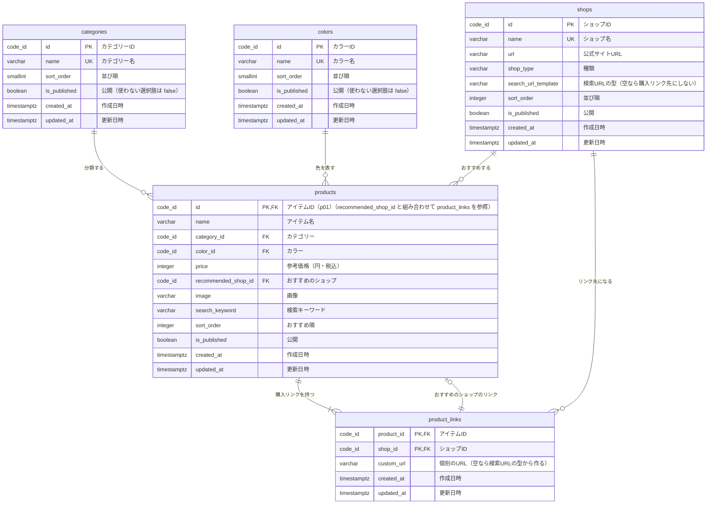
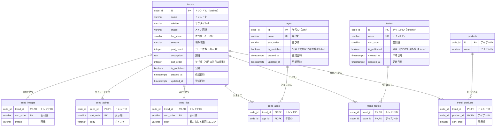
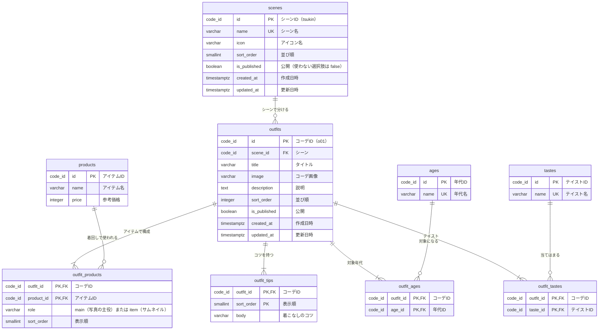
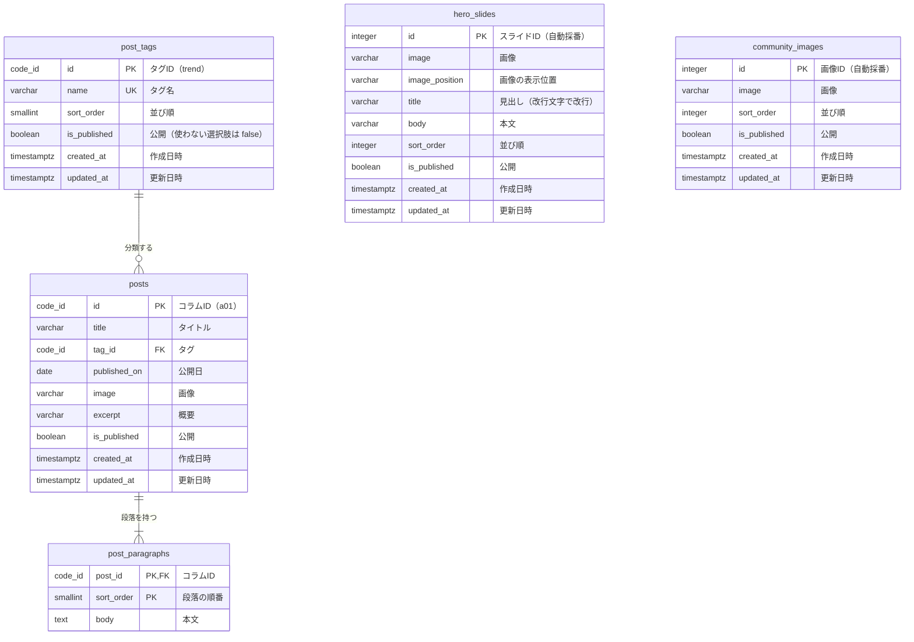
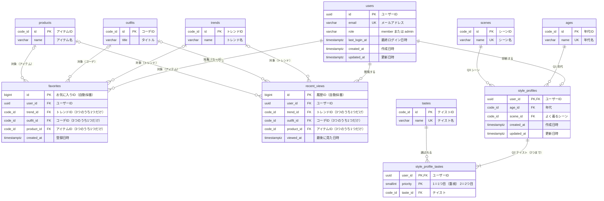
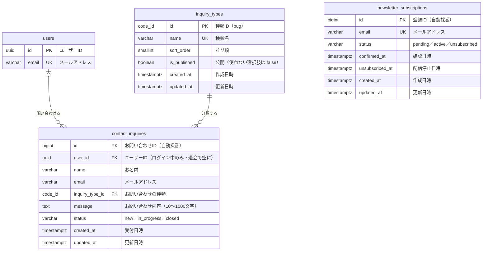
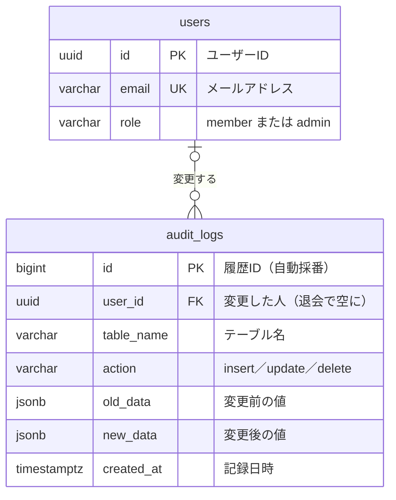

# ER図（エンティティ関連図）

**プロジェクト名（仮）：** ファッショントレンド・コーディネート支援Webアプリ「StyleHer（スタイルハー）」
**作成日：** 2026年9月29日
**版数：** v0.2（DB設計書 v0.2 の設計レビューを反映）
**関連文書：** [DB設計書](db.md) / [設計書](../設計書.md) / [プロジェクト仕様書・要件定義 v0.2](../プロジェクト仕様書_要件定義.md)

---

## 1. 図の読み方

本書は、[DB設計書](db.md) で定めた34テーブルのつながりを図にしたものである。各列の型・制約の詳細は DB設計書の4章を参照。

図は Mermaid で書いている。GitHub や、Mermaid に対応したエディター（VS Code の拡張機能など）で開くと図として表示される。

- **箱** がテーブル、**線** がテーブル同士のつながり（外部キー）を表す。
- 線の上の文字は、つながりの意味を表す。
- 箱の中の `PK` は主キー、`FK` は外部キー、`UK` は一意（重複不可）を表す。
- 型の `code_id` は、文字列ID用のドメイン（`varchar(30)`、英小文字・数字・`_` のみ）を表す。

**線の端の記号**

| 線の端の形 | Mermaid での書き方 | 意味 |
|---|---|---|
| 縦線2本 | `\|\|` | ちょうど1つ |
| 丸と縦線 | `\|o` / `o\|` | 0または1つ |
| 縦線と三つ又 | `}\|` / `\|{` | 1つ以上 |
| 丸と三つ又 | `}o` / `o{` | 0以上 |

例：`outfits ||--|{ outfit_products` は「1つのコーデには、コーデのアイテムが1つ以上ある。コーデのアイテムの1行は、ちょうど1つのコーデに属する」という意味。

> 「1つ以上」は業務上のルール（必ず1件以上登録するもの。[設計書](../設計書.md) 6.2 で「必須」とした項目など）を表す。最低1件あることはDBの制約ではなく、管理画面で保存するときに確認する。

---

## 2. 全体図

全テーブルと、そのつながりだけを表示する（列は省略）。

```mermaid
erDiagram
  %% ショップ・アイテム
  categories ||--o{ products : "分類する"
  colors ||--o{ products : "色を表す"
  shops ||--o{ products : "おすすめする"
  products ||--|{ product_links : "購入リンクを持つ"
  shops ||--o{ product_links : "リンク先になる"

  %% トレンド
  trends ||--|{ trend_images : "画像を持つ"
  trends ||--|{ trend_points : "ポイントを持つ"
  trends ||--|{ trend_tips : "コツを持つ"
  trends ||--|{ trend_ages : "対象年代"
  ages ||--o{ trend_ages : ""
  trends ||--|{ trend_tastes : "テイスト"
  tastes ||--o{ trend_tastes : ""
  trends ||--|{ trend_products : "関連アイテム"
  products ||--o{ trend_products : ""

  %% コーデ
  scenes ||--o{ outfits : "シーンで分ける"
  outfits ||--|{ outfit_products : "アイテムで構成"
  products ||--o{ outfit_products : "着回しで使われる"
  outfits ||--|{ outfit_tips : "コツを持つ"
  outfits ||--|{ outfit_ages : "対象年代"
  ages ||--o{ outfit_ages : ""
  outfits ||--|{ outfit_tastes : "テイスト"
  tastes ||--o{ outfit_tastes : ""

  %% コラム
  post_tags ||--o{ posts : "分類する"
  posts ||--|{ post_paragraphs : "段落を持つ"

  %% ユーザー
  users ||--o{ favorites : "お気に入りする"
  trends |o--o{ favorites : ""
  outfits |o--o{ favorites : ""
  products |o--o{ favorites : ""
  users ||--o{ recent_views : "閲覧する"
  trends |o--o{ recent_views : ""
  outfits |o--o{ recent_views : ""
  products |o--o{ recent_views : ""
  users ||--o| style_profiles : "診断する"
  ages ||--o{ style_profiles : ""
  scenes ||--o{ style_profiles : ""
  style_profiles ||--|{ style_profile_tastes : "テイストを選ぶ"
  tastes ||--o{ style_profile_tastes : ""

  %% 受付
  users |o--o{ contact_inquiries : "問い合わせる"
  inquiry_types ||--o{ contact_inquiries : "分類する"

  %% 運用
  users |o--o{ audit_logs : "変更する"

  %% ほかのテーブルとつながらないテーブル
  hero_slides {
    integer id PK
  }
  community_images {
    integer id PK
  }
  newsletter_subscriptions {
    bigint id PK
  }
```

**グループの分け方**

| グループ | テーブル |
|---|---|
| マスタ | `scenes`, `ages`, `tastes`, `categories`, `colors`, `post_tags`, `inquiry_types` |
| ショップ・アイテム | `shops`, `products`, `product_links` |
| トレンド | `trends`, `trend_images`, `trend_points`, `trend_tips`, `trend_ages`, `trend_tastes`, `trend_products` |
| コーデ | `outfits`, `outfit_products`, `outfit_tips`, `outfit_ages`, `outfit_tastes` |
| コラム・トップページ | `posts`, `post_paragraphs`, `hero_slides`, `community_images` |
| ユーザー | `users`, `favorites`, `recent_views`, `style_profiles`, `style_profile_tastes` |
| 受付 | `newsletter_subscriptions`, `contact_inquiries` |
| 運用 | `audit_logs` |

---

## 3. グループ別の詳細図

グループごとに、列まで表示する。ほかのグループのテーブルは、つながりが分かるように主な列だけを表示する。

### 3.1 ショップ・アイテム

- `shops` は、ショップ一覧（F-17）に出すショップと、購入リンク（F-10）の行き先のECサイトを兼ねる。
- `products` と `shops` は2通りにつながる。「おすすめのショップ」（`recommended_shop_id`）と、「購入リンク」（`product_links`）。
- `products` の (`id`, `recommended_shop_id`) は `product_links` を参照する（外部キー `fk_products_recommended_link`）。そのため、おすすめのショップの購入リンクは必ずある。
- 購入リンクのURLは保存せず、`custom_url` が空のときは `shops.search_url_template` と `products.search_keyword` から作る。

### 3.2 トレンド

### 3.3 コーデ

- `outfit_products` は、現在のデータの `main`（写真の主役アイテム）と `items`（サムネイルのアイテム）を `role` 列で見分けて1つにまとめたもの。`main` は1コーデに1つまで。
- 着回し数（F-11）は「`outfit_products` にそのアイテムが何行あるか」、コーデの合計金額（F-07）は「そのコーデの `outfit_products` のアイテムの `price` の合計」で求める。

### 3.4 コラム・トップページ

`hero_slides`（メインビジュアル）と `community_images`（コミュニティ告知の画像）は、ほかのテーブルとつながらない。

### 3.5 ユーザー（F-21 会員登録の実現時に使う）

- `favorites` と `recent_views` は、`trend_id` / `outfit_id` / `product_id` の **どれか1つだけ** に値が入る（CHECK 制約）。そのため、トレンド・コーデ・アイテムの側から見ると「0または1つ」（`|o`）のつながりになる。
- 同じ人が同じものを二重に登録することはできない（一意制約）。`recent_views` は1人最大8件。
- `style_profiles` は1人に0件か1件（診断していない人は0件）。
- ユーザーを削除（退会）すると、お気に入り・最近見たもの・診断結果も一緒に消える。

### 3.6 受付

- お問い合わせは、ログインしていなくても送れる（`user_id` は空でもよい）。退会しても、対応の記録として残す（`user_id` だけ空にする）。
- メールマガジン登録は会員登録と関係なく受け付けるため、`users` とはつながらない。

### 3.7 運用

- `audit_logs` は、マスタ・コンテンツの26テーブルの変更をトリガーで自動的に記録する。どのテーブルの変更かは `table_name` で表し、外部キーではつながない（行が削除されても履歴を残すため）。
- 個人のデータ（お気に入り・履歴・お問い合わせなど）の変更は記録しない。

---

## 4. 主なつながりの説明

| つながり | 種類 | 意味 | 実現方法 |
|---|---|---|---|
| カテゴリー・カラー → アイテム | 1対多 | 1つのアイテムは、1つのカテゴリー・1つのカラーに属する | `products.category_id` / `color_id` |
| ショップ → アイテム（おすすめ） | 1対多 | アイテムごとに、おすすめのショップが1つ決まっている | `products.recommended_shop_id` |
| アイテム ⇔ ショップ（購入リンク） | 多対多 | 1つのアイテムに複数のECサイトの購入リンクがあり、比べて選べる（F-10） | 中間テーブル `product_links` |
| トレンド ⇔ 年代・テイスト | 多対多 | 1つのトレンドが複数の年代・テイストに当てはまる | 中間テーブル `trend_ages` / `trend_tastes` |
| トレンド ⇔ アイテム | 多対多 | トレンドごとに関連アイテムを紹介する。1つのアイテムが複数のトレンドに出てもよい | 中間テーブル `trend_products` |
| シーン → コーデ | 1対多 | 1つのコーデは、1つのシーンに属する | `outfits.scene_id` |
| コーデ ⇔ アイテム | 多対多 | 1つのコーデは複数のアイテムで組み立て、1つのアイテムは複数のコーデで使う（着回し・F-11） | 中間テーブル `outfit_products` |
| コーデ ⇔ 年代・テイスト | 多対多 | 1つのコーデが複数の年代・テイストに当てはまる | 中間テーブル `outfit_ages` / `outfit_tastes` |
| タグ → コラム | 1対多 | 1つのコラムに、1つのタグ | `posts.tag_id` |
| トレンド・コーデ・コラム → 文章・画像 | 1対多 | ポイント・コツ・段落・追加画像を、順番つきで複数持つ | 子テーブル（`trend_points` など）の `sort_order` |
| ユーザー → お気に入り・最近見たもの | 1対多 | 1人が複数のお気に入り・履歴を持つ | `favorites.user_id` / `recent_views.user_id` |
| お気に入り・最近見たもの → 対象 | 排他的な参照 | トレンド・コーデ・アイテムのどれか1つを指す | 3つの外部キーのうち1つだけに値を入れる（CHECK 制約） |
| ユーザー → 診断結果 | 1対0または1 | 1人1件まで | `style_profiles.user_id`（主キー） |
| 診断結果 ⇔ テイスト | 多対多（2つまで・順番あり） | 1つ目に選んだテイストを重視して点数を付ける | 中間テーブル `style_profile_tastes` の `priority` |
| ユーザー → お問い合わせ | 0または1対多 | ログインしていなくても送れる | `contact_inquiries.user_id`（空でもよい） |
| お問い合わせの種類 → お問い合わせ | 1対多 | | `contact_inquiries.inquiry_type_id` |
| 購入リンク → アイテム（おすすめ） | 1対0または1 | おすすめのショップの購入リンクが必ずある | `products (id, recommended_shop_id)` → `product_links`（コミット時に確認） |
| ユーザー → 変更履歴 | 0または1対多 | 運営者の変更を記録する。SQLで直接変えたときは変更した人が空 | `audit_logs.user_id` |

---

## 改訂履歴

| 版数 | 日付 | 内容 |
|---|---|---|
| v0.1 | 2026年9月29日 | 初版作成（DB設計書 v0.1 にもとづく） |
| v0.2 | 2026年9月29日 | DB設計書 v0.2 に合わせて更新（`audit_logs` の追加、マスタの公開フラグ・タイムスタンプ、購入リンクの `custom_url`、ID の型を `code_id` に） |
